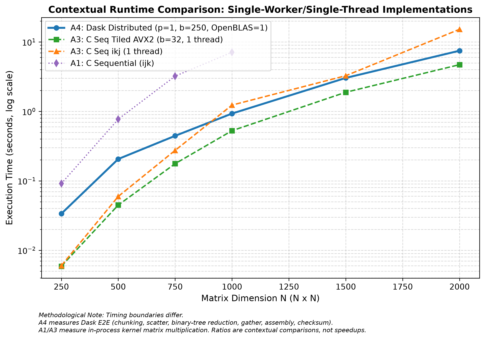

# Scalability, Memory Footprint, and Framework Overhead in Distributed Matrix Multiplication using Dask Distributed

**Assignment 4 Research Report**  
**Course:** BIG DATA · Grado en Ciencia e Ingeniería de Datos  
**Academic Year:** 2026–2027  
**Author:** Abel Castro Villar  
**Institution:** Universidad de Las Palmas de Gran Canaria (ULPGC)  
**Repository:** [Assignment04_Abel](https://github.com/abelcasv/Assignment04_Abel)  
**Date:** November 2026  

---

## Abstract

This study investigates the execution time scaling, local multi-worker strong scaling, process memory footprint, and framework coordination overhead of dense square matrix multiplication ($C = A \times B$) implemented with **Dask Distributed** on an asymmetric hybrid x86-64 processor (Intel Core i5-1335U: 2 Performance cores, 8 Efficient cores, 16 GB RAM, Windows 11). The implementation partitions dense IEEE 754 `binary64` (`float64`) matrices using a **2D block decomposition** ($b = 250$) and accumulates partial products across output blocks via a **pairwise binary-tree reduction**, executing local block multiplications with single-threaded OpenBLAS (`threads_per_worker = 1`, `OPENBLAS_NUM_THREADS = 1`). All primary timed runs execute one unmeasured warm-up and five measured repetitions within a strict pre-registered end-to-end timing boundary ($T_{\text{Dask\_E2E}}$), guarded by an external 2.5 GiB aggregate RSS watchdog and 120.0 s per-sample timeout.

In the frozen Phase 8 single-worker baseline sweep ($p = 1$, $n \in \{250, 500, 750, 1000, 1500, 2000\}$), Dask end-to-end latency scales from a median of $0.0336\text{ s}$ ($\text{IQR} = 0.0032\text{ s}$) at $n=250$ to $7.4963\text{ s}$ ($\text{IQR} = 0.0952\text{ s}$) at $n=2000$. At small dimensions ($n \le 500$), Dask Distributed is substantially slower than optimized in-process C kernels—at $n=250$, Dask ($0.0336\text{ s}$) is $5.6\times$ slower than the single-threaded A3 OpenMP kernel ($0.0060\text{ s}$, $\text{CTR}=0.18\times$)—whereas it outperforms cache-unfriendly stride-$n$ A1 C $i\text{-}j\text{-}k$ ($0.0912\text{ s}$, $\text{CTR}=2.71\times$). At larger dimensions, Dask/OpenBLAS overtakes A1 Java by $n=500$ ($1.67\times$) and untiled A3 $i\text{-}k\text{-}j$ at $n=1000$ ($1.06\times$, reaching $2.18\times$ at $n=2000$), yet remains slower than hardware-tailored cache-blocked AVX2 routines across every tested dimension up to $n=2000$ ($4.7202\text{ s}$, $\text{CTR}=0.63\times$).

Following confirmed instructor authorization under revised institutional policy DEC-01 (`docs/decisions/DEC-01-instructor-permission.md`, 2026-11-23), an authorized **local single-host multi-worker strong-scaling campaign** ($p \in \{1, 2, 4, 8, 10\}$, $n \in \{1000, 1500, 2000\}$, $b=250$, `physical_machine_count=1`, `1 + p` OS processes—executed as five consecutive single-`p` sub-campaigns inside one continuous 26.6 min invocation) and a separate $n=1000$ diagnostic pass were executed without modifying the frozen 48-row historical dataset. Positive median strong-scaling speedup emerges **only** at the largest tested workload with two workers ($n=2000, p=2$: median $9.5635\text{ s}$ vs. $11.6333\text{ s}$ in the preceding Nov 23 $p=1$ sub-campaign, $S_{\text{dist}} = 1.22\times$, $E_{\text{dist}} = 60.8\%$, with overlapping per-repetition ranges). Scaling beyond two workers ($p \in \{4, 8, 10\}$) induces sharp non-monotonic slowdown across all dimensions ($S(4) = 0.21\times\text{–}0.77\times$, $S(8) = 0.12\times\text{–}0.34\times$) and reaches the 120.0 s timeout at $p=10$ ($131.92\text{ s}$ on $n=1500$ rep 5). Separate diagnostics rule out RAM exhaustion, disk spilling (`0 B`; peak RSS $\le 1{,}468.1\text{ MiB} \ll 2{,}560\text{ MiB}$), and BLAS compute ($\le 0.335\text{ s}$ aggregate), showing that driver `scatter_s`, `wait_s`, and `gather_s` represent `96.11%` of wall-clock latency at $p=8$ (`98.70%` including `graph_submission_s`), consistent with architectural hypotheses of centralized scheduler contention, Windows loopback TCP IPC overhead, and hybrid P/E-core scheduling. All multi-worker runs are explicitly labeled as single-host process emulation; genuine multi-node execution remains **BLOCKED / NOT AVAILABLE**. Finally, assembly inspection of Assignment 1 confirms its harness consumed only $c[0]$, whereas Assignment 4 consumes the full assembled matrix via checksum inside $T_{\text{Dask\_E2E}}$ and validates element-by-element numerical accuracy at $n=250$ ($\max|\Delta| = 1.137 \times 10^{-13} \ll 10^{-9}$) and $C_{500}$ ($p=2$ vs. $p=1$, $\max|\Delta|=0.0$).

---

## 1. Introduction and Objectives

Dense matrix multiplication is a fundamental computational kernel across numerical linear algebra, scientific computing, and big data analytics [Golub2013]. For two square matrices $A, B \in \mathbb{R}^{n \times n}$, the multiplication operation $C = A \times B$ computes $n^2$ inner products:
$$C_{i, j} = \sum_{k=0}^{n-1} A_{i, k} \cdot B_{k, j}$$
This operation exhibits an arithmetic complexity of $2n^3$ floating-point operations (FLOPs) and a minimal structural storage footprint of $3 \times 8n^2 = 24n^2\text{ bytes}$ across the three operands under IEEE 754 `binary64` representation [IEEE754] (an architectural storage lower bound rather than measured loopback IPC transfer). Because arithmetic work scales cubically ($\mathcal{O}(n^3)$) while data volume scales quadratically ($\mathcal{O}(n^2)$), dense matrix multiplication provides high computational intensity ($\mathcal{O}(n)$ FLOPs per byte transferred), making it a canonical workload for investigating parallel and distributed execution paradigms.

In distributed computing frameworks such as MapReduce-style dataflow engines [Dean2008], Dask Distributed [Rocklin2015], Apache Spark, or Ray, matrix operations are decomposed into discrete tasks distributed across independent processes or networked worker nodes. However, distributed execution introduces non-trivial system overheads, including:
1. Directed Acyclic Graph (DAG) construction and validation;
2. Task scheduling and serialization over TCP/IP sockets;
3. Inter-process communication (IPC) and memory copying;
4. Intermediate reduction synchronization;
5. Driver gathering and dense array assembly.

### 1.1 Research Question
In accordance with the official course specification (`docs/reference/BD_Individual_Assignments_2026_2027.pdf`, page 7) [CourseSpec], this study addresses the broader assignment research objective:
> **How does the end-to-end wall-clock performance, process memory footprint, and scheduling/communication overhead of a distributed 2D block matrix multiplication implementation using Dask Distributed scale as matrix dimensions increase and across worker topologies, and how does it compare contextually with sequential (Assignment 1) and shared-memory parallel OpenMP (Assignment 3) implementations across matching dimensions and IEEE 754 `binary64` numeric types?**

*Experimental Scope Note (DEC-01):* During Phases 1–10, Gate G1 / DEC-01 restricted execution to $p=1$ pending instructor permission, producing the frozen 48-row single-worker dataset (lines 1–49 of `results/raw/raw_measurements.csv`, preserved byte-for-byte). Following confirmed instructor authorization on 2026-11-23 (`docs/decisions/DEC-01-instructor-permission.md`), an authorized local single-host multi-worker strong-scaling campaign ($p \in \{1, 2, 4, 8, 10\}$, $n \in \{1000, 1500, 2000\}$, $b=250$, `physical_machine_count=1`) and a separate $n=1000$ diagnostic pass were executed and appended non-destructively (90 new rows). Because no multi-node cluster was available, **genuine multi-node execution remains BLOCKED / NOT AVAILABLE**, and all multi-worker measurements are strictly labeled as **single-host local multi-process execution**. Contextual comparisons in Section 4.2 use frozen historical baseline summaries (`data/baselines/a1_summary.csv` and `data/baselines/a3_parallel_results_summary.csv`), while A4's deterministic dataset (`data/dense/`) and runtime adapters prepare identical inputs for optional local re-execution.

### 1.2 Hypotheses
* **$H_1$ (Framework Overhead at Small Dimensions, $n \le 500$):** For small problem sizes ($n \le 500$), graph submission, task serialization, local socket IPC, and driver gathering are hypothesized to exceed raw arithmetic execution time, causing Dask end-to-end latency to be substantially higher than native in-process C kernels ($\text{CTR} = \tilde{T}_{\text{baseline}} / \tilde{T}_{\text{Dask}} < 1$). Empirically **partially supported (baseline-dependent)**.
* **$H_2$ (Larger-Dimension Scaling, Baseline Crossovers & Multi-Worker Granularity, $n \ge 1000$):** Evaluates whether cubic computational growth ($2n^3$) as dimension grows ($n \ge 1000$) amortizes fixed framework coordination costs both against in-process baselines at $p=1$ and across multiple local workers ($p > 1$). Empirically **partially supported**: baseline-specific crossovers occur at $p=1$, and positive strong-scaling speedup occurs **only** at $n=2000, p=2$ ($S_{\text{dist}} = 1.22\times$, $E_{\text{dist}} = 60.8\%$).
* **$H_3$ (Worker Saturation & Scaling Limits on Asymmetric Single Host):** On a shared-memory hybrid host, increasing worker process counts beyond physical performance cores induces coordination contention, memory-bus/IPC pressure, and core-heterogeneity imbalance, leading to non-monotonic scaling degradation. Empirically **supported**: $p \in \{4, 8, 10\}$ degrades steeply across all tested sizes and hits the 120.0 s timeout at $p=10$.
* **$H_4$ (Contextual Cross-System Comparison):** Runtime differences between Dask/NumPy [VanDerWalt2011] and C/OpenMP baselines reflect fundamentally non-equivalent runtime backends, memory representations, and timing boundaries, representing a cross-system contextual comparison rather than an isolated algorithmic speedup. Empirically **supported**.

---

## 2. Background and Related Work

### 2.1 Distributed Matrix Multiplication Algorithms
Classical distributed matrix multiplication algorithms partition input matrices across a two-dimensional grid of processors. Standard approaches include:
1. **Cannon’s Algorithm (1969):** Employs a 2D toroidal processor grid with initial circular shifting of blocks, followed by stepwise local multiplication and shift-accumulation stages. While communication-optimal for square grids, Cannon's algorithm requires synchronized lock-step execution and strict square processor topologies ($p = q^2$).
2. **Fox’s Algorithm (1987):** Uses broadcast of diagonal blocks combined with circular upward shifting of $B$ blocks, accommodating general topologies but requiring broadcast primitives.
3. **PUMMA and SUMMA (Van de Geijn & Watts, 1997) [VanDeGeijn1997]:** Scalable Universal Matrix Multiplication Algorithm (SUMMA) broadcasts rows of $A$ and columns of $B$ across processor grids. SUMMA forms the foundation of ScaLAPACK's `P{D,S}GEMM` due to its robustness against arbitrary aspect ratios and asynchronous communication tolerance.
4. **2D Block Tree Reduction (This Study):** In dynamic task-graph frameworks such as Dask Distributed [Rocklin2015], a decentralized 2D block decomposition is natural. Slicing $A$ and $B$ into $b \times b$ blocks yields $N_b^3$ independent multiplication tasks ($P_{i, j, k} = A_{i, k} \times B_{k, j}$). Combining partial products for each output block $(i, j)$ via a pairwise binary reduction tree minimizes serialization depth to $\lceil \log_2 N_b \rceil$ stages, allowing dynamic asynchronous execution.

### 2.2 Dask Distributed Framework Architecture
Dask is a flexible open-source parallel computing library in Python composed of two primary components:
1. **Dynamic Task Scheduling:** A centralized `Scheduler` process tracks dependencies across a directed acyclic graph (DAG) of tasks, assigning ready tasks to available `Worker` processes.
2. **Distributed Data Collections:** High-level arrays and dataframes that map coarse-grained operations into discrete task graphs.

In this study, to maintain exact algorithmic control and prevent opaque internal optimization heuristics from obscuring experimental measurements, we avoid high-level `dask.array` abstractions. Instead, we implement the 2D block multiplication and binary-tree reduction directly using low-level Dask `Client.submit` and `Client.scatter` primitives, ensuring explicit task graph topology and exact tracking of task futures.

---

## 3. Experimental Methodology

### 3.1 Distributed Architecture & Mathematical Formulation

Let $A, B \in \mathbb{R}^{n \times n}$ be dense square matrices stored in IEEE 754 `binary64` (`float64`) precision. The matrices are partitioned into an $N_b \times N_b$ grid of sub-blocks using a fixed block dimension $b = 250$:
$$N_b = \left\lceil \frac{n}{b} \right\rceil$$

For each output block coordinate $(i, j) \in \{0, \dots, N_b - 1\}^2$, the output block is mathematically defined as:
$$C_{i, j} = \sum_{k=0}^{N_b - 1} A_{i, k} \times B_{k, j}$$

```
                2D Block Matrix Multiplication Pipeline
                
    Matrix A (n x n)              Matrix B (n x n)
    +-----+-----+                  +-----+-----+
    | A00 | A01 |                  | B00 | B01 |
    +-----+-----+                  +-----+-----+
    | A10 | A11 |                  | B10 | B11 |
    +-----+-----+                  +-----+-----+
           \                            /
            \                          /
             v                        v
       [2D Slicing: b x b Contiguous C-Order Slices]
                           |
                           v
              [Scatter to Dask Cluster Memory]
                           |
                           v
           [Multiplication Stage: Nb^3 Tasks]
     P000 = A00 x B00    P001 = A01 x B10   ... (numpy.matmul)
                           |
                           v
         [Pairwise Binary-Tree Reduction: Nb^2 DAGs]
             Stage 0: Add(P000, P001) -> C00_accum
                 Depth: ceil(log2(Nb)) stages
                           |
                           v
       [Gather Output Blocks C_ij to Driver Process]
                           |
                           v
        [Dense Matrix Assembly: C (n x n float64)]
                           |
                           v
      [Full-Matrix Checksum Barrier: float(np.sum(C))]
```

#### Edge-Block Truncation Policy
When matrix side length $n$ is not divisible by $b$, edge blocks adopt exact truncated dimensions:
$$\text{block\_rows} = \min(b, n - i \cdot b), \quad \text{block\_cols} = \min(b, n - j \cdot b)$$
Zero-padding is strictly forbidden by `SPEC.md` §5.1 to preserve exact computational complexity. Every slice is forced into contiguous C-order layout (`np.ascontiguousarray(..., dtype=np.float64)`).

#### Binary-Tree Reduction Graph
For each output block $(i, j)$, the $N_b$ partial product futures are reduced hierarchically:
- Round 0 pairs adjacent futures $(P_{i, j, 0}, P_{i, j, 1}), (P_{i, j, 2}, P_{i, j, 3}), \dots$ and submits `block_add` tasks.
- Unpaired odd futures automatically carry forward to the next round.
- Reduction continues iteratively until a single accumulated future remains.
- Tree depth is $\lceil \log_2 N_b \rceil$, requiring exactly $N_b - 1$ additions per output block.
- Total task count for dimension $n$:
  $$\text{Tasks}_{\text{total}} = N_b^3 + N_b^2 (N_b - 1) = 2 N_b^3 - N_b^2$$

At $n=2000$ ($N_b=8$), the execution graph contains $512$ multiplications and $448$ additions, totaling $960$ discrete Dask tasks.

### 3.2 Hardware Environment & Runtime Topology

Experiments were conducted on a dedicated host running Windows 11 Home 64-bit (Build 10.0.26300):
* **Processor:** Intel Core i5-1335U (Raptor Lake, 10 physical cores: 2 Performance cores with Hyper-Threading, 8 Efficient cores; 12 logical processors). Base clock 1.30 GHz, max turbo boost up to 4.60 GHz. L1 data cache $48\text{ KB}$ per P-core / $32\text{ KB}$ per E-core; L2 cache $1.25\text{ MB}$ per P-core / $2\text{ MB}$ shared per 4 E-cores; shared L3 cache $12\text{ MB}$.
* **System Memory:** 16.0 GB total physical DDR4 RAM (16,009.14 MiB / 15.63 GiB; 3,688.8 MiB / ~3.60 GiB available at idle baseline).
* **Software Stack:** Python 3.14.0 (MSC v.1944 64-bit AMD64), Dask Distributed 2026.8.0, NumPy 2.5.4, SciPy OpenBLAS 0.3.34.106.0 (`libscipy_openblas64`), psutil 7.2.2, Matplotlib 3.11.2, threadpoolctl 3.7.0. C baselines compiled with MinGW-W64 GCC 13.2.0.

#### Process Identity & Concurrency Isolation
Dask was launched via `LocalCluster(processes=True, n_workers=p, threads_per_worker=1)` on a single Windows host:
* **Driver Process (1 PID):** Houses the `Client`, `LocalCluster` orchestrator, in-process `Scheduler`, and in-process `Nanny` management controller (`nanny_pids = []` after PID deduplication; in the frozen Nov 14 Phase 8 sidecar, `nanny_pids: [21036]` delegated to the worker PID).
* **Worker Processes ($p$ distinct child OS PIDs):** Spawned independent child Python processes executing OpenBLAS block kernels.
* **Observed Operating System Process Mapping:** Across all executed configurations, Windows `LocalCluster(processes=True)` spawned exactly **`1 + p` distinct OS PIDs**: `2` ($p=1$), `3` ($p=2$), `5` ($p=4$), `9` ($p=8$), and `11` ($p=10$), all executing on `physical_machine_count = 1`.
* **Threading Policy:** Dask framework concurrency was pinned to 1 thread per worker (`threads_per_worker = 1`), and OpenBLAS internal multi-threading was pinned to 1 thread via environment variables (`OPENBLAS_NUM_THREADS=1`, `MKL_NUM_THREADS=1`, `OMP_NUM_THREADS=1`, `NUMEXPR_NUM_THREADS=1`), verified dynamically via `threadpoolctl`.

### 3.3 Institutional Permission Gate & Strong Scaling Status (DEC-01)
Course specification requirement A4-11 states that local multi-worker execution ($p > 1$) requires explicit instructor permission and clear environment labeling. Under decision DEC-01 (`docs/decisions/DEC-01-instructor-permission.md`):
* **Historical Phase 1–10 Restriction (Preserved):** Single-worker execution ($p = 1$) was executed in Phase 8 while $p > 1$ remained blocked pending instructor approval. Its 48 raw rows are preserved byte-for-byte in lines 1–49 of `results/raw/raw_measurements.csv`.
* **Revised Authorization (2026-11-23):** Following confirmed instructor permission for local multi-worker experimentation, Gate G1 natively authorized local single-host multi-process strong scaling across $p \in \{1, 2, 4, 8, 10\}$ on `physical_machine_count = 1` under all existing operational safeguards (2.5 GiB RSS ceiling, 1.0 GiB host RAM floor, 120.0 s timeout).
* **Strong Scaling Status (Single-Host Local):** **COMPLETED (Local Single-Host Multi-Process)** for $p \in \{1, 2, 4, 8\}$ across $n \in \{1000, 1500, 2000\}$, with $p = 10$ empirically hitting the 120.0 s timeout ceiling at $n=1500$ repetition 5 (`131.92 s`; 4/5 completed, 1 `TIMEOUT`, 12 `NOT_RUN_AFTER_TIMEOUT`).
* **Multi-Node & Inter-Machine Networking Disclosure (A4-12):** No accredited multi-node cluster or university HPC environment was available; genuine **multi-node execution remains BLOCKED / NOT AVAILABLE**, and inter-machine network costs were not isolated because all multi-worker IPC traversed Windows loopback (`127.0.0.1`).
* **Optional Weak Scaling (DEC-07):** Equal-work dense cubic weak scaling obeys $W(n) = 2n^3 \implies n(p) = n(1) \cdot p^{1/3}$. It remains **deferred** per DEC-07 because strong scaling on a single host already saturates beyond $p=2$ and hits the 120.0 s timeout at $p=10$, so generating new non-frozen weak-scaling input files on 1 physical host would not isolate multi-node scaling behavior.

### 3.4 Timing Contracts & Measurement Boundaries

To satisfy COM-05 and COM-06, the primary timing boundary $T_{\text{Dask\_E2E}}$ is defined monotonically ($t_0 \to t_1$) via `time.perf_counter()`:
1. **Excluded Setup:** Cluster startup (`cluster_startup_s = 4.816 s` in Phase 8; `3.11 s` to `20.80 s` across the strong-scaling $p \in \{1, 2, 4, 8, 10\}$ sub-campaigns) and CSV matrix loading from disk (`input_load_s`, ranging from $0.161\text{ s}$ at $n=250$ to $6.478\text{ s}$ at $n=2000$ in Phase 8) are measured and recorded outside $T_{\text{Dask\_E2E}}$.
2. **Start Event ($t_0$):** Sampled immediately before 2D block partitioning of $A$ and $B$.
3. **Included Operations:** 2D slicing, scattering blocks to worker memory, graph submission ($N_b^3$ multiplications and $N_b^2(N_b-1)$ additions), graph execution, gathering output blocks to driver memory, dense array assembly, and full-matrix checksum consumption.
4. **Stop Event ($t_1$):** Sampled immediately after checksum consumption (`checksum = float(np.sum(C, dtype=np.float64))`).
5. **Excluded Verification:** Element-by-element numerical validation against reference data occurs after $t_1$.

### 3.5 Numerical Correctness & Acceptance Tolerances
Prior to benchmarking, the implementation passed six correctness fixtures:
1. Identity matrix: $A \times I = A$.
2. Zero matrix: $A \times 0 = 0$.
3. Integer $4 \times 4$ fixture matrix with known exact output.
4. Edge-block truncation fixture: $4 \times 4$ matrix with block size $b=3$.
5. Non-finite check: Zero `NaN` or `Inf` values permitted.
6. Independent numerical reference validation: At $n=250$, output was compared element-by-element against `data/validation/reference/C_250.csv` (SHA-256 `598E9A9FC8F0...`), generated independently via pure standard-library Python loops.

Acceptance criterion:
$$|C_{\text{test}}[i, j] - C_{\text{ref}}[i, j]| \le \text{atol} + \text{rtol} \cdot |C_{\text{ref}}[i, j]|$$
The independent element-wise validation at $n=250$ used a tolerance-based acceptance criterion ($\text{atol}=10^{-9}, \text{rtol}=10^{-12}$) against an independent calculated numerical reference (`data/validation/reference/C_250.csv`, generated via `scripts/generate_dataset.py`'s `generate_reference_product()` using an independent standard-library Python scalar loop without BLAS or Dask). Across all $62,500$ elements, OpenBLAS `np.matmul` ($b=250$) achieved $\max|\Delta| = 1.137 \times 10^{-13}$ ($\max_{\text{rel}} = 1.896 \times 10^{-15}$, consistent with IEEE 754 AVX2/FMA vs. scalar summation rounding; `scripts/verify_correctness.py` with $b=100$ achieved $1.208 \times 10^{-13}$, $\max_{\text{rel}} = 2.015 \times 10^{-15}$), four orders of magnitude within tolerance, while exact $0.0$ difference held for the $4 \times 4$ integer fixtures, the $n=250$ aggregate checksum difference, and the $C_{500}$ ($p=2$ vs. $p=1$) cross-validation. For larger dimensions ($n \ge 500$), checksum determinism was confirmed by verifying zero checksum divergence ($\Delta = 0.0$) across all completed repetitions. Note that checksum determinism confirms identical aggregate checksum values across repetitions, but does not prove that complete output matrices are identical (as distinct matrices may produce the same aggregate sum) and is not equivalent to independent element-by-element reference validation.

### 3.6 Resource Safeguards & Watchdog Protocol
To protect host stability, a background `ResourceWatchdog` thread sampled active cluster PIDs every $250\text{ ms}$:
* Aggregate process RSS ceiling: $2.5\text{ GiB}$ ($2560.0\text{ MiB}$).
* Minimum host available RAM floor: $1.0\text{ GiB}$ ($1024.0\text{ MiB}$).
* Execution budgets: $120.0\text{ s}$ per-sample timeout, $10.0\text{ h}$ total campaign budget, $60.0\text{ s}$ cluster startup timeout.
* Safe abort sequence: Cancel in-flight futures, close cluster within $5\text{ s}$, terminate lingering child PIDs (`terminate() / kill()`), and log status as `OUT_OF_MEMORY`, `ABORTED_WATCHDOG`, or `ABORTED_BUDGET`.

---

## 4. Empirical Results and Statistical Analysis

The certified dataset comprises **138 raw records** in `results/raw/raw_measurements.csv` (full SHA-256 `831A731D9DF6073F3D19AD4A7D4E4F8B54E04D39CFE463D298857F26F4ED426C`), preserving the 48 original Phase 7–8 rows byte-for-byte in lines 1–49 (prefix SHA-256 `3D9D721343D379C26F61DD6B4669979F6E7E5262E0D8F6E96CD4D26B1F0FE92C`):
* **Pilot 1 (6 rows, Phase 7):** Executed with a $30.0\text{ s}$ startup timeout; all 6 samples failed due to cold cluster initialization timeout on Windows.
* **Pilot 2 (6 rows, Phase 7):** Executed with startup timeout raised to $60.0\text{ s}$; all 6 samples completed successfully (2 warm-ups, 4 measured).
* **Phase 8 Single-Worker Campaign (36 rows, $p=1$):** Evaluated $n \in \{250, 500, 750, 1000, 1500, 2000\}$ with 1 warm-up and 5 measured repetitions per size in randomized order (seed `20261113`). All 36 samples completed (`largest_attempted_n = 2000`, `largest_completed_n = 2000`) with 0 timeouts and 0 memory breaches.
* **Authorized Local Multi-Worker Strong-Scaling Campaign (90 rows, DEC-01, 2026-11-23):** Evaluated $p \in \{1, 2, 4, 8, 10\}$ across $n \in \{1000, 1500, 2000\}$ ($b=250$, 1 warm-up + 5 measured repetitions per `(n, p)` cell, seed `20261113`, 1 physical host, `1 + p` OS PIDs), indexed in `results/metadata/strong_scaling_manifest.json`. All 72 samples for $p \in \{1, 2, 4, 8\}$ completed (`18/18` each); at $p=10$, 5 samples completed (`n=1500` warm-up + reps 1–4), repetition 5 hit the $120.0\text{ s}$ timeout (`131.92 s`), and the remaining 12 samples were logged `NOT_RUN_AFTER_TIMEOUT`.
* **Auxiliary Verification & Diagnostic Artifacts (outside `raw_measurements.csv`):** A controlled $p=1$ vs. $p=2$ multi-worker pilot (`results/metadata/pilot_multiworker_p1_p2.json`) and a separate $n=1000$ task-stream/phase diagnostic characterization pass (`results/metadata/strong_scaling_diagnostics.json`).

### 4.1 Single-Worker Dask Scaling Results ($p = 1, b = 250$)

Table 1 summarizes descriptive statistics across the 30 non-warmup campaign samples:

**Table 1: Dask Distributed Single-Worker Execution Statistics ($p=1, b=250$, OpenBLAS=1)**

| Dimension $n$ | Blocks $N_b$ | Total Tasks | Samples | Mean $T_{\text{E2E}}$ (s) | Median $T_{\text{E2E}}$ (s) | Std Dev (s) | IQR (s) | Min (s) | Max (s) | Peak RSS (MiB) |
|:---:|:---:|:---:|:---:|:---:|:---:|:---:|:---:|:---:|:---:|:---:|
| **250** | 1 | 1 | 5 | 0.0349 | **0.0336** | 0.0057 | 0.0032 | 0.0300 | 0.0446 | 796.7* |
| **500** | 2 | 12 | 5 | 0.2024 | **0.2062** | 0.0270 | 0.0160 | 0.1621 | 0.2362 | 796.7* |
| **750** | 3 | 45 | 5 | 0.4480 | **0.4449** | 0.0521 | 0.0733 | 0.3798 | 0.5063 | 327.3 |
| **1000** | 4 | 112 | 5 | 0.9804 | **0.9318** | 0.1140 | 0.1228 | 0.8695 | 1.1528 | 525.6* |
| **1500** | 6 | 396 | 5 | 3.2977 | **3.0392** | 0.5197 | 0.7948 | 2.7801 | 3.9470 | 525.6 |
| **2000** | 8 | 960 | 5 | 7.3006 | **7.4963** | 0.6079 | 0.0952 | 6.2562 | 7.8475 | 796.7 |

*\*Note on memory & telemetry completeness: (1) Peak RSS reports the maximum `rss_process_sum_peak_sampled_mib` across the five measured repetitions per dimension (on Windows `psutil` `.rss` measures Working Set, and `peak_working_set_mib` in the frozen CSV records max 250 ms-sampled single-PID RSS rather than OS `PeakWorkingSetSize`). Because the frozen campaign ran before `ResourceWatchdog` added per-sample windowing (`mark_sample_start()`/`get_window_metrics()`), $n=1000$ ($525.6\text{ MiB}$; per-sample driver RSS `244.7–260.4 MiB`) inherits the $n=1500$ high-water mark and $n \in \{250, 500\}$ ($796.7\text{ MiB}$; per-sample driver RSS `246.8–253.5 MiB`) inherit the $n=2000$ high-water mark in the randomized sequence ($750 \to 1500 \to 1000 \to 2000 \to 250 \to 500$), whereas Pilot 2's isolated runs recorded `162.9 MiB` ($n=250$) and `178.3 MiB` ($n=500$). (2) Online validation (`campaign_runner.py`) verified full IEEE-754 `float64` checksums (`atol = 1e-6`), while `results_logger.py` formatted `checksum_sum >= 1e8` (`n >= 750`) as `:.6e` (7 significant digits) in the frozen CSV (remediated to `%.17g` for future runs). (3) In `results/raw/raw_measurements.csv`, `object_nbytes` is `NULL` because `Client.nbytes()` returns a dictionary in Dask Distributed, which raised `TypeError` in `int(self.client.nbytes())` during the frozen campaign (since fixed via `extract_object_nbytes()`); directional transfer columns (`client_to_worker_payload_bytes`, `worker_to_worker_payload_bytes`, `worker_to_client_payload_bytes`, `compressed_transfer_bytes`, `transfer_metric_source`, `dask_managed_memory_mib`) remain `NULL` because inline instrumentation was omitted to avoid perturbing `TB_DASK_E2E`. (4) `DistributedBlockMatmul.multiply()` populates an in-memory `phase_breakdown_s` dictionary (`partitioning_s`, `scatter_s`, `graph_submission_s`, `gather_s`, `assembly_s`, `checksum_s`) on `DaskExecutionResult` for diagnostic inspection, which is not serialized to the 44-column raw CSV schema.*

*Figure 1 illustrates runtime scaling on linear and log-log scales alongside an unfitted theoretical $\mathcal{O}(n^3)$ reference.*


#### Scaling Rate Analysis
Between $n=250$ and $n=500$ (a $2\times$ dimension increase), median runtime increases by $6.13\times$ ($0.0336\text{ s} \to 0.2062\text{ s}$), well below the theoretical cubic scaling factor of $2^3 = 8\times$. This reflects the substantial fixed cost of cluster scatter and checksum overhead at $n=250$. Between $n=1000$ and $n=2000$, median runtime increases by $8.05\times$ ($0.9318\text{ s} \to 7.4963\text{ s}$), closely matching the theoretical cubic scaling ratio ($2^3 = 8.0\times$), which is consistent with cubic computational work growing faster than quadratic task coordination costs, although individual phase durations were not separately measured.

### 4.2 Contextual Baseline Comparisons

The distributed Dask implementation was compared contextually against frozen historical baseline summaries from Assignment 1 (`data/baselines/a1_summary.csv`) and Assignment 3 (`data/baselines/a3_parallel_results_summary.csv`) across matching dimensions and IEEE 754 `binary64` numeric types (originally measured on each prior assignment's own random inputs; A4's common `data/dense/` matrices and runtime adapters in `scripts/` enable optional local re-execution on identical inputs). The **Contextual Duration Ratio** is defined as:
$$\text{CTR} = \frac{\tilde{T}_{\text{baseline}}}{\tilde{T}_{\text{Dask\_p1}}}$$
where $\text{CTR} > 1.0$ denotes that the baseline duration was longer than Dask E2E duration, and $\text{CTR} < 1.0$ denotes that the baseline duration was shorter than Dask E2E duration. These ratios represent system-level contextual comparisons under differing timing boundaries (`TB_KERNEL_ONLY` vs `TB_DASK_E2E`), not isolated algorithmic speedups.

**Table 2: Contextual Comparison of Single-Threaded Implementations across Common Dimensions**

| Dimension $n$ | Baseline Method | Baseline Median (s) | Dask $p=1$ Median (s) | Contextual Ratio | Methodological Interpretation |
|:---:|---|:---:|:---:|:---:|---|
| **250** | A1 C Sequential ($i\text{-}j\text{-}k$) | 0.0912 | 0.0336 | **2.71×** | Baseline duration > Dask duration |
| **250** | A1 Java Sequential | 0.0276 | 0.0336 | **0.82×** | Baseline duration < Dask duration |
| **250** | A1 Python Sequential | 11.0849 | 0.0336 | **329.83×** | Baseline duration > Dask duration |
| **250** | A3 C OpenMP $i\text{-}k\text{-}j$ ($p=1$) | 0.0060 | 0.0336 | **0.18×** | Baseline duration < Dask duration |
| **250** | A3 C Seq Tiled AVX2 ($b=32$) | 0.0059 | 0.0336 | **0.18×** | Baseline duration < Dask duration |
| **500** | A1 C Sequential ($i\text{-}j\text{-}k$) | 0.7726 | 0.2062 | **3.75×** | Baseline duration > Dask duration |
| **500** | A1 Java Sequential | 0.3437 | 0.2062 | **1.67×** | Baseline duration > Dask duration |
| **500** | A1 Python Sequential | 99.9401 | 0.2062 | **484.75×** | Baseline duration > Dask duration |
| **500** | A3 C OpenMP $i\text{-}k\text{-}j$ ($p=1$) | 0.0640 | 0.2062 | **0.31×** | Baseline duration < Dask duration |
| **500** | A3 C Seq Tiled AVX2 ($b=32$) | 0.0447 | 0.2062 | **0.22×** | Baseline duration < Dask duration |
| **750** | A1 C Sequential ($i\text{-}j\text{-}k$) | 3.2241 | 0.4449 | **7.25×** | Baseline duration > Dask duration |
| **750** | A1 Java Sequential | 1.4662 | 0.4449 | **3.30×** | Baseline duration > Dask duration |
| **750** | A3 C OpenMP $i\text{-}k\text{-}j$ ($p=1$) | 0.3099 | 0.4449 | **0.70×** | Baseline duration < Dask duration |
| **750** | A3 C Seq Tiled AVX2 ($b=32$) | 0.1765 | 0.4449 | **0.40×** | Baseline duration < Dask duration |
| **1000** | A1 C Sequential ($i\text{-}j\text{-}k$) | 7.1264 | 0.9318 | **7.65×** | Baseline duration > Dask duration |
| **1000** | A1 Java Sequential | 3.3293 | 0.9318 | **3.57×** | Baseline duration > Dask duration |
| **1000** | A3 C OpenMP $i\text{-}k\text{-}j$ ($p=1$) | 0.9893 | 0.9318 | **1.06×** | Baseline duration > Dask duration |
| **1000** | A3 C Seq Tiled AVX2 ($b=32$) | 0.5276 | 0.9318 | **0.57×** | Baseline duration < Dask duration |
| **1500** | A3 C OpenMP $i\text{-}k\text{-}j$ ($p=1$) | 6.5549 | 3.0392 | **2.16×** | Baseline duration > Dask duration |
| **1500** | A3 C Seq Tiled AVX2 ($b=32$) | 1.8883 | 3.0392 | **0.62×** | Baseline duration < Dask duration |
| **2000** | A3 C OpenMP $i\text{-}k\text{-}j$ ($p=1$) | 16.3745 | 7.4963 | **2.18×** | Baseline duration > Dask duration |
| **2000** | A3 C Seq Tiled AVX2 ($b=32$) | 4.7202 | 7.4963 | **0.63×** | Baseline duration < Dask duration |

*Note on contextual baseline selection & multi-threaded OpenMP context: Table 2 presents 22 representative single-worker/single-thread comparisons selected from the 34 single-thread ($t=1$) records in the underlying contextual baseline CSV (`results/analysis/contextual_baseline_comparison.csv`) to match A4's Phase 8 $p=1$ concurrency. For each of the six dimensions, it omits the alternative single-threaded representation `A3_Seq_ikj` in favor of `A3_OpenMP_ikj_p1`, and `A3_OpenMP_tiled_b32_p1` in favor of `A3_Seq_tiled_b32`. Separately, the frozen Assignment 3 summary (`data/baselines/a3_parallel_results_summary.csv`) also records multi-threaded shared-memory OpenMP medians—specifically at $t=10$ threads matching the 10 physical cores: untiled `omp_ikj` runs in $0.0019\text{ s}$ ($n=250$) to $1.5443\text{ s}$ ($n=2000$, $4.85\times$ shorter than Phase 8 Dask $p=1$ and $6.19\times$ shorter than Dask's best local multi-worker result $9.5635\text{ s}$ at $p=2$), and `omp_tiled_b32` runs in $0.0016\text{ s}$ ($n=250$) to $0.6250\text{ s}$ ($n=2000$, $11.99\times$ shorter than Dask $p=1$ and $15.30\times$ shorter than Dask $p=2$). These shared-memory timings are reported as cross-system context illustrating zero-copy shared-memory threading versus multi-process distributed orchestration.*

*Figure 2 displays the contextual execution time comparison across four representative single-worker/single-thread implementations (`A4 Dask p=1`, `A3 C Seq Tiled AVX2 b=32`, `A3 C Seq ikj`, `A1 C Seq ijk`) on a logarithmic scale.*



### 4.3 Local Multi-Worker Strong Scaling ($p \in \{1, 2, 4, 8, 10\}, n \in \{1000, 1500, 2000\}, b = 250$)

#### Controlled Multi-Worker Pilot Verification ($p=1$ vs. $p=2$)
Before executing the strong-scaling sweep, `scripts/run_strong_scaling.py --pilot-p1-p2` (`results/metadata/pilot_multiworker_p1_p2.json`) verified real multi-worker execution on `physical_machine_count = 1`:
* **OS Process Identity:** `p=1` spawned 2 unique OS PIDs (`driver=20292`, `worker=11588`, `nanny_pids=[]`); `p=2` spawned 3 unique OS PIDs (`driver=20292`, `workers=[26936, 12804]`, `nanny_pids=[]`).
* **Numerical Equivalence:** Element-wise validation at $n=250$ yielded $\max|\Delta| = 1.137 \times 10^{-13} \ll 10^{-9}$ for both $p=1$ and $p=2$; full 250,000-element cross-validation of $C_{500}$ between $p=2$ and $p=1$ yielded `max_abs_diff = 0.0` and `max_rel_diff = 0.0` (`passed = True`).
* **Real Multi-Worker Activity & Clean Teardown:** At $p=2, n=500$, the 12 DAG tasks split evenly across both workers (`6+6` in reps 0–1, `5+7` in rep 2), emitting real `transfer` actions (`0.0215–0.0345 s`, `2–7` incoming worker transfers) and closing with 0 surviving worker PIDs.

#### Strong-Scaling Speedup and Efficiency Results
To avoid mixing cross-day measurements against the frozen Nov 14 Phase 8 rows (`0.9318 s / 3.0392 s / 7.4963 s`), `scripts/run_strong_scaling.py --campaign` ran five consecutive single-`p` sub-campaigns (`p = 1 → 2 → 4 → 8 → 10`, each with its own `run_id`, fresh `LocalCluster`, and sidecar, separated by 1.5 s pauses) inside one continuous 26.6 min invocation on 2026-11-23 (`driver_pid = 15160`, `13:25:55Z–13:52:28Z`, host available RAM `4263–4891 MiB`). No `p=1` reference was interleaved inside each `p > 1` cluster session, and `p` order was fixed ascending rather than randomized; consequently, residual intra-sweep thermal and turbo-frequency drift on Windows is not fully eliminated (as also evidenced by the `13:52Z` diagnostic `n=1000, p=1` run taking `0.368 s` vs. `1.5287 s` in the `13:26Z` `p=1` sub-campaign). Strong-scaling speedup and parallel efficiency are computed strictly against the Nov 23 `p=1` sub-campaign (`campaign_20261123_132555_...`: `1.5287 s / 6.0131 s / 11.6333 s`):
$$S_{\text{dist}}(p, n) = \frac{\tilde{T}_{\text{Dask\_E2E}}(1, n)}{\tilde{T}_{\text{Dask\_E2E}}(p, n)}, \qquad E_{\text{dist}}(p, n) = \frac{S_{\text{dist}}(p, n)}{p}$$

**Table 3: Local Single-Host Multi-Worker Strong-Scaling Summary ($b=250$, OpenBLAS=1, 1 Physical Host, $N=5$ Measured Reps)**

| Dimension $n$ | Workers $p$ | OS PIDs | Completed | Median $T_{\text{E2E}}$ (s) | IQR (s) | Mean (s) | Speedup $S_{\text{dist}}(p)$ | Efficiency $E_{\text{dist}}(p)$ | Peak RSS (MiB) | Dask Managed (MiB) | Status |
|:---:|:---:|:---:|:---:|:---:|:---:|:---:|:---:|:---:|:---:|:---:|:---|
| **1000** | 1 | 2 | 5/5 | **1.5287** | 0.5568 | 1.7350 | 1.00× | 100.0% | 407.7 | 53.4 | `COMPLETED` ($\Delta=0.0$) |
| **1000** | 2 | 3 | 5/5 | **2.3203** | 0.4401 | 2.5033 | 0.66× | 32.9% | 535.9 | 69.1 | `COMPLETED` ($\Delta=0.0$) |
| **1000** | 4 | 5 | 5/5 | **7.3915** | 0.6233 | 7.5670 | 0.21× | 5.2% | 733.7 | 70.1 | `COMPLETED` ($\Delta=0.0$) |
| **1000** | 8 | 9 | 5/5 | **12.9262** | 14.7408 | 18.3671 | 0.12× | 1.5% | 1075.2 | 63.4 | `COMPLETED` ($\Delta=0.0$) |
| **1000** | 10 | 11 | 0/5 | — | — | — | N/A | N/A | — | — | `NOT_RUN_AFTER_TIMEOUT` |
| **1500** | 1 | 2 | 5/5 | **6.0131** | 0.8975 | 6.3114 | 1.00× | 100.0% | 520.1 | 154.5 | `COMPLETED` ($\Delta=0.0$) |
| **1500** | 2 | 3 | 5/5 | **7.9502** | 1.8595 | 7.9982 | 0.76× | 37.8% | 692.5 | 205.5 | `COMPLETED` ($\Delta=0.0$) |
| **1500** | 4 | 5 | 5/5 | **7.8444** | 1.1721 | 9.1675 | 0.77× | 19.2% | 866.5 | 206.5 | `COMPLETED` ($\Delta=0.0$) |
| **1500** | 8 | 9 | 5/5 | **17.7094** | 2.9573 | 17.0143 | 0.34× | 4.2% | 1173.2 | 165.9 | `COMPLETED` ($\Delta=0.0$) |
| **1500** | 10 | 11 | 4/5 | *40.3655\** | *41.7125\** | *54.8795\** | N/A | N/A | 1360.0 | 154.5 | `PARTIAL_TIMEOUT` (rep 5: 131.92 s) |
| **2000** | 1 | 2 | 5/5 | **11.6333** | 1.2076 | 11.2135 | 1.00× | 100.0% | 787.1 | 335.7 | `COMPLETED` ($\Delta=0.0$) |
| **2000** | 2 | 3 | 5/5 | **9.5635** | 2.4293 | 10.1923 | **1.22×** | **60.8%** | 967.8 | 408.2 | `COMPLETED` ($\Delta=0.0$) |
| **2000** | 4 | 5 | 5/5 | **39.1173** | 9.6631 | 35.7538 | 0.30× | 7.4% | 1133.5 | 356.7 | `COMPLETED` ($\Delta=0.0$) |
| **2000** | 8 | 9 | 5/5 | **43.8998** | 24.0615 | 41.2992 | 0.26× | 3.3% | 1468.1 | 337.6 | `COMPLETED` ($\Delta=0.0$) |
| **2000** | 10 | 11 | 0/5 | — | — | — | N/A | N/A | — | — | `NOT_RUN_AFTER_TIMEOUT` |

*\*Protocol §11.3 Note: At $p=10, n=1500$, repetition 5 exceeded the 120.0 s timeout (`131.92 s`), triggering immediate cluster shutdown without unauthorized restart and marking $n=2000$ and $n=1000$ as `NOT_RUN_AFTER_TIMEOUT`. The 4-sample partial timing is reported transparently for context, while official $S(10)$ and $E(10)$ are omitted (`N/A`). All completed rows achieved exact full-precision checksum invariance ($\Delta = 0.0$), populated `object_nbytes` (`72/234/544 MB` structural post-gather totals, i.e., `72,000,000`, `234,000,000`, and `544,000,000` bytes), and `0` watchdog/OOM breaches (max Peak RSS $1{,}468.1\text{ MiB} \ll 2{,}560\text{ MiB}$ cap).*

*Figure 3 illustrates local multi-worker runtime scaling (left) and strong-scaling speedup $S_{\text{dist}}(p, n)$ relative to ideal linear speedup and the $S=1.0$ breakeven threshold (right).*


#### Separate Task-Stream & Phase Diagnostic Characterization ($n=1000, b=250$)
Per `docs/experimental_protocol.md` §7.1, diagnostic telemetry was collected in a separate pass (`results/metadata/strong_scaling_diagnostics.json`, $n=1000$, 112 tasks: 64 `matmul` + 48 `add`) so `get_task_stream()` hooks never perturbed primary timed runs:

**Table 4: Separate Diagnostic Breakdown at $n=1000, b=250$ (Driver Wall-Clock Phases vs. Overlapping Worker Task-Stream Totals)**

| Workers $p$ | OS PIDs | $T_{\text{E2E}}$ (s) | Driver `scatter` (s) | Driver `submit` (s) | Driver `wait` (s) | Driver `gather` (s) | Agg. Worker `compute` (s)\* | Agg. Worker `transfer` (s)\* | Incoming Transfers | Tasks per Worker | Spilled (B) |
|:---:|:---:|:---:|:---:|:---:|:---:|:---:|:---:|:---:|:---:|---|:---:|
| **1** | 2 | 0.368 | 0.102 | 0.038 | 0.185 | 0.036 | 0.089 | 0.000 | 0 | `[112]` | 0 |
| **2** | 3 | 2.825 | 0.718 | 0.489 | 1.377 | 0.206 | 0.283 | 0.188 | 48 | `[57, 55]` | 0 |
| **4** | 5 | 5.772 | 1.028 | 0.562 | 3.713 | 0.294 | 0.254 | 0.200 | 68 | `[29, 27, 28, 28]` | 0 |
| **8** | 9 | 82.379 | 27.309 | 2.133 | 27.834 | 24.028 | 0.335 | 0.654 | 101 | `[14, 17, 13, 19, 12, 14, 14, 9]` | 0 |
| **10** | 11 | `TIMEOUT` | — | — | — | — | — | — | — | 10 workers registered; warm-up timed out at 121.38 s | — |

*\*Methodological Telemetry Note: (1) Driver phases (`partitioning_s` + `scatter_s` + `graph_submission_s` + `wait_s` + `gather_s` + `assembly_s` + `checksum_s`) partition wall-clock $T_{\text{Dask\_E2E}}$ directly, whereas `total_compute_s` and `total_transfer_s` from `client.get_task_stream()` are **overlapping aggregate sums across concurrent workers** and must NOT be added as disjoint components of $T_{\text{E2E}}$. (2) In Dask Distributed 2026.8.0, `metrics["transfer"]["incoming_bytes"]` / `["outgoing_bytes"]` act as instantaneous in-flight gauges (returning to `0` once transfers drain), so inter-worker communication is empirically quantified via cumulative `incoming_count_total` deltas (`0 → 48 → 68 → 101`) and task-stream `transfer` durations (`0.000 → 0.188 → 0.200 → 0.654 s`); NumPy `float64` transfers emit `action="transfer"` without a separate `"deserialize"` event.*

---

## 5. Discussion

### 5.1 Verification of Hypotheses

#### Hypothesis 1: Framework Overhead Dominance ($H_1$ Partially Supported — Baseline-Dependent)
Empirical results for $n \le 500$ are baseline-dependent and partially support $H_1$. Against all optimized Assignment 3 in-process C baselines (`A3_OpenMP_ikj_p1`, `A3_Seq_ikj`, `A3_OpenMP_tiled_b32_p1`, `A3_Seq_tiled_b32`), Dask end-to-end execution ($0.0336\text{ s}$ at $n=250$; $0.2062\text{ s}$ at $n=500$) is substantially slower, yielding $\text{CTR} = 0.17\times\text{–}0.18\times$ at $n=250$ ($0.0057\text{–}0.0060\text{ s}$) and $\text{CTR} = 0.22\times\text{–}0.31\times$ at $n=500$ ($0.0447\text{–}0.0640\text{ s}$), and likewise slower than `A1_Seq_Java` at $n=250$ ($\text{CTR} = 0.82\times$, $0.0276\text{ s}$). Conversely, $H_1$ is refuted in net wall-clock duration at $n \le 500$ against cache-unfriendly stride-$n$ `A1_Seq_C_ijk` ($0.0912\text{ s}$, $\text{CTR}=2.71\times$ at $n=250$; $0.7726\text{ s}$, $\text{CTR}=3.75\times$ at $n=500$), `A1_Seq_Java` at $n=500$ ($0.3437\text{ s}$, $\text{CTR}=1.67\times$), and interpreted `A1_Seq_Python` ($11.0849\text{ s}$, $\text{CTR}=329.83\times$ at $n=250$; $99.9401\text{ s}$, $\text{CTR}=484.75\times$ at $n=500$), because OpenBLAS's AVX2 microkernel offsets Dask's framework coordination overhead when compared against unblocked or interpreted loops.

#### Hypothesis 2: Larger-Dimension Scaling, Baseline Crossovers & Multi-Worker Granularity ($H_2$ Partially Supported)
$H_2$ evaluates both whether cubic arithmetic growth ($2n^3$, expanding $512\times$ from $0.031\text{ GFLOP}$ at $n=250$ to $16.0\text{ GFLOP}$ at $n=2000$) amortizes framework coordination overhead at $p=1$ and whether larger workloads yield positive multi-worker speedup:
* **Single-Worker Contextual Crossovers ($p=1$):** `A1_Seq_Java` crosses $\text{CTR}=1.0$ between $n=250$ ($0.82\times$) and $n=500$ ($1.67\times$, reaching $3.57\times$ at $n=1000$); untiled `A3_OpenMP_ikj_p1` / `A3_Seq_ikj` cross at $n=1000$ ($1.06\times$ / $1.32\times$, reaching $2.18\times$ / $2.04\times$ at $n=2000$ once untiled C exceeds L3 cache capacity); `A1_Seq_C_ijk` and Python exceed $1.0$ at all tested sizes; and **no crossover occurs through $n=2000$** against cache-blocked AVX2 `A3_Seq_tiled_b32` / `A3_OpenMP_tiled_b32_p1` ($\text{CTR}=0.63\times$ / $0.57\times$ at $n=2000$).
* **Multi-Worker Granularity ($p > 1$, Local Single Host):** Table 3 confirms that task granularity is decisive: at $n=1000$ (112 tasks, $2.0\text{ GFLOP}$) and $n=1500$ (396 tasks, $6.75\text{ GFLOP}$), even $p=2$ incurs a net slowdown ($S_{\text{dist}} = 0.66\times$ and $0.76\times$). Only at $n=2000$ (960 tasks, $16.0\text{ GFLOP}$) with $p=2$ does median execution time improve relative to the Nov 23 $p=1$ sub-campaign, yielding **$S_{\text{dist}}(2, 2000) = 1.22\times$ ($E_{\text{dist}} = 60.8\%$, median $9.5635\text{ s}$ vs. $11.6333\text{ s}$)**. Even in that sole positive cell, per-repetition durations overlap (`[8.49, 12.75] s`, $\text{IQR}=1.21\text{ s}$ at $p=1$ vs. `[9.01, 11.68] s`, $\text{IQR}=2.43\text{ s}$ at $p=2$, with `p=1` rep 3 at `8.49 s` faster than all `p=2` repetitions), so the $1.22\times$ median gain is modest and does not generalize to smaller tested sizes.

#### Hypothesis 3: Worker Saturation & Scaling Limits on Asymmetric Single Host ($H_3$ Empirically Supported)
The authorized strong-scaling sweep and separate diagnostic pass **empirically support $H_3$**. Increasing worker count past two workers ($p \in \{4, 8, 10\}$) causes rapid, non-monotonic scaling degradation across every tested matrix size:
1. **Measured Slowdown and Tail Variance:** At $p=4$, speedup drops to $0.21\times$ ($n=1000$), $0.77\times$ ($n=1500$), and $0.30\times$ ($n=2000$); at $p=8$, speedup falls to $0.12\times\text{–}0.34\times$ while dispersion surges ($\text{IQR} = 14.74\text{ s}$ at $n=1000$ and $24.06\text{ s}$ at $n=2000$). At $p=10$, repetition 5 of $n=1500$ exceeds the $120.0\text{ s}$ timeout (`131.92 s`, with the preceding four completed reps spanning `22.32 s` to `116.47 s`), independently corroborated by the $n=1000$ diagnostic warm-up timing out at `121.38 s`.
2. **Measured Phase Breakdown vs. Architectural Hypotheses (Ruling Out RAM & Compute):** Table 4 directly **rules out** memory exhaustion, disk spilling (`0 B`; peak RSS $1{,}075.2\text{ MiB}$ at $n=1000, p=8$ and max $1{,}468.1\text{ MiB}$ at $n=2000, p=8 \ll 2{,}560\text{ MiB}$ cap), and OpenBLAS compute time (overlapping aggregate worker compute across all 112 tasks totals only $0.335\text{ s}$, $\le 0.41\%$ of $82.38\text{ s}$). Directly measured driver phases show `scatter_s` ($27.31\text{ s}$), `wait_s` ($27.83\text{ s}$, which encloses concurrent worker execution and coordination wait), and `gather_s` ($24.03\text{ s}$) accounting for **`96.11%`** of $T_{\text{E2E}}$ (`98.70%` including `graph_submission_s = 2.13 s`), alongside rising inter-worker transfer counts (`0 → 48 → 68 → 101`). As **architectural hypotheses consistent with these measurements**—but not isolated separately via OS socket, Tornado event-loop, or core-affinity profiling—the non-compute wall-clock growth aligns with centralized in-process Tornado scheduler contention, Windows loopback TCP socket serialization/IPC overhead, and asymmetric scheduling across the CPU's 2 P-cores + 8 E-cores.

#### Hypothesis 4: System-Level Contextual Comparisons ($H_4$ Supported)
The cross-assignment comparisons confirm $H_4$. Presenting a ratio such as $\text{CTR} = 7.65\times$ (Dask vs. A1 C) as a "distributed speedup" would be methodologically false because timing scopes (`TB_KERNEL_ONLY` vs. `TB_DASK_E2E`), computational libraries (OpenBLAS vs. naive triple loop), and memory layouts differ fundamentally. Conversely, comparing Dask's best local multi-worker time at $n=2000$ ($9.5635\text{ s}$ at $p=2$) against Assignment 3's 10-thread shared-memory OpenMP kernels (`omp_tiled_b32`: $0.6250\text{ s}$, $15.3\times$ faster; `omp_ikj`: $1.5443\text{ s}$, $6.2\times$ faster) demonstrates why zero-copy shared-memory parallelism decisively outperforms multi-process distributed frameworks on a single machine.

### 5.2 A1 Compiler Optimization Inspection & Scientific Implications
In accordance with `SPEC.md` DEC-04, Phase 5 inspected the assembly output of `baselines/a1_sequential/benchmark.c` (`build/bin/a1_benchmark.s`) compiled under `-O3`. The inspection confirmed:
1. The inspected GCC 13.2.0 (`-O3`) assembly confirmed that the complete $\mathcal{O}(n^3)$ loop body survived dead-code elimination in the compiled binary (`.L63`, `.L69`, `.L65`), vectorizing the innermost loop with packed SSE/AVX instructions (`movupd`, `mulpd`, `unpckhpd`). The binary did not demonstrate elimination of the multiplication loop.
2. However, the benchmark harness consumed only $c[0]$ via a volatile sink (`result_sink = c[0]`).
3. Consequently, the remaining $n^2 - 1$ output elements were never validated for numerical correctness during benchmarking.
4. **Consequence for Interpreting A1 Timing:** While the measured A1 execution time reflects the actual execution of the complete $\mathcal{O}(n^3)$ loop in the inspected binary, the harness suffered from a structural validation deficiency because it failed to certify that the computed result matrix was numerically correct beyond $c[0]$. In Assignment 4, the full-matrix checksum consumes all elements of the assembled array within the timed boundary, while numerical validation is provided by element-by-element reference validation at $n=250$ and checksum determinism across repetitions (zero observed checksum divergence, $\Delta = 0.0$) for $n \ge 500$.

### 5.3 Local Process Emulation vs. True Physical Clustering & Weak Scaling Assessment
In compliance with requirement A4-12, all single-worker and multi-worker experiments ($p \in \{1, 2, 4, 8, 10\}$) are explicitly designated as **single-host process emulation** (`physical_machine_count = 1`):
* Communication occurred exclusively over Windows loopback sockets (`127.0.0.1`), entirely bypassing physical network interface cards.
* Memory was allocated from a single shared physical pool ($16\text{ GB}$ DRAM), where each added Python worker process contributed `+80–160 MiB` of working set without multiplying aggregate physical memory capacity across machines.
* Inter-process communication did not encounter packet routing, network interface queueing, MTU fragmentation, or physical switch contention—yet coordination and data-movement phases (`scatter_s`, `graph_submission_s`, `wait_s`, `gather_s`) dominated wall-clock time for $p \ge 4$, consistent with local IPC and scheduler contention rather than RAM limits.
* While local multi-worker emulation rigorously characterizes Dask scheduling overhead, task balance, process memory scaling, and local multi-process saturation, it **cannot** be extrapolated to physical multi-node cluster scaling or inter-machine network throughput.
* **Weak Scaling (DEC-07, Optional & Deferred):** Maintaining constant theoretical arithmetic work per worker for dense cubic multiplication ($W(n) = 2n^3$) requires $n(p) = n(1) \cdot p^{1/3}$. Because single-host strong scaling already saturates beyond $p=2$ and hits the $120.0\text{ s}$ timeout at $p=10$, generating new non-frozen weak-scaling matrices on the same single host would not provide valid multi-node scalability evidence; weak scaling therefore remains deferred.

---

## 6. Conclusions

This study provides a controlled, empirical evaluation of distributed 2D block matrix multiplication using Dask Distributed across both a frozen six-size single-worker baseline ($p=1$) and an authorized local multi-worker strong-scaling campaign ($p \in \{1, 2, 4, 8, 10\}$). Within the tested single-host scope, the following conclusions are established:
1. **Framework Coordination Overhead & Baseline-Specific Crossovers ($H_1, H_2$ Partially Supported):** At small dimensions ($n \le 500$), Dask Distributed is substantially slower than optimized in-process C kernels ($\text{CTR} = 0.17\times\text{–}0.31\times$ vs. A3 baselines), while OpenBLAS still beats stride-$n$ A1 C ($2.71\times\text{–}3.75\times$) and Python ($\ge 329.8\times$). At larger dimensions ($p=1$), Dask overtakes A1 Java by $n=500$ ($1.67\times$) and untiled A3 $i\text{-}k\text{-}j$ at $n=1000$ ($1.06\times$, reaching $2.18\times$ at $n=2000$), yet exhibits **no crossover through $n=2000$** against cache-blocked AVX2 C kernels (`A3_Seq_tiled_b32`: $\text{CTR} = 0.63\times$).
2. **Local Multi-Worker Strong Scaling & Coordination Saturation ($H_2$ Partial, $H_3$ Empirically Supported):** Across five consecutive single-`p` sub-campaigns ($p = 1 \to 2 \to 4 \to 8 \to 10$) on 1 physical host (`1 + p` OS PIDs), positive median speedup appears **only** at $n=2000, p=2$ ($S_{\text{dist}} = 1.22\times$, $E_{\text{dist}} = 60.8\%$, with overlapping repetition ranges `[8.49, 12.75] s` vs. `[9.01, 11.68] s`). Beyond $p=2$, runtime degrades sharply ($S(4)=0.21\times\text{–}0.77\times$, $S(8)=0.12\times\text{–}0.34\times$, $\text{IQR}$ up to $24.06\text{ s}$) and reaches the `120.0 s` timeout at $p=10$ (`131.92 s` on $n=1500$ rep 5). Separate diagnostics verify balanced task placement and rule out disk spilling (`0 B`; max RSS $1{,}468.1\text{ MiB} \ll 2{,}560\text{ MiB}$ cap) and BLAS compute ($\le 0.335\text{ s}$), measuring `96.11%` of wall-clock latency at $p=8$ in `scatter_s` + `wait_s` + `gather_s` (`98.70%` including `graph_submission_s`), consistent with architectural hypotheses of centralized scheduler, loopback IPC, and P/E-core scheduling contention.
3. **Numerical Correctness & Cross-System Boundaries ($H_4$ Supported):** The 2D block decomposition with pairwise tree reduction passed element-by-element validation against an independent reference at $n=250$ ($\max|\Delta| = 1.137 \times 10^{-13}$ for $b=250$, $1.208 \times 10^{-13}$ for $b=100$, well within $\text{atol}=10^{-9}, \text{rtol}=10^{-12}$; aggregate checksum diff `0.0`), exact 250,000-element cross-validation of $C_{500}$ between $p=2$ and $p=1$ ($\max|\Delta|=0.0$), and exact checksum invariance ($\Delta = 0.0$) across all **119 completed rows** (out of 138 logged; 19 failed/timed-out/skipped rows record empty checksums). Comparisons against zero-copy shared-memory OpenMP $t=10$ (`0.6250 s` vs. Dask's best $9.5635\text{ s}$ at $n=2000$) confirm that distributed frameworks should not be expected to beat shared-memory threading on a single host.
4. **Remaining Scope Limitation:** Because no accredited multi-node cluster was available, genuine inter-machine network scaling, multi-node memory aggregation, and optional weak scaling (DEC-07) remain **out of scope / future work on physical multi-node infrastructure**.

---

## 7. References and Materials

### 7.1 References
1. **[Dean2008]** J. Dean and S. Ghemawat, "MapReduce: Simplified data processing on large clusters," *Communications of the ACM*, vol. 51, no. 1, pp. 107–113, 2008.
2. **[Rocklin2015]** M. Rocklin, "Dask: Parallel computation with blocked algorithms and task scheduling," in *Proc. 14th Python in Science Conf. (SciPy)*, 2015, pp. 130–136.
3. **[VanDeGeijn1997]** R. A. van de Geijn and J. Watts, "SUMMA: Scalable universal matrix multiplication algorithm," *Concurrency: Practice and Experience*, vol. 9, no. 4, pp. 255–274, 1997.
4. **[Golub2013]** G. H. Golub and C. F. Van Loan, *Matrix Computations*, 4th ed. Baltimore, MD: Johns Hopkins University Press, 2013.
5. **[VanDerWalt2011]** S. van der Walt, S. C. Colbert, and G. Varoquaux, "The NumPy array: A structure for efficient numerical computation," *Computing in Science & Engineering*, vol. 13, no. 2, pp. 22–30, 2011.
6. **[IEEE754]** *IEEE Standard for Floating-Point Arithmetic*, IEEE Std 754-2019, 2019.
7. **[CourseSpec]** Universidad de Las Palmas de Gran Canaria, "Individual Assignments: Matrix Multiplication," Big Data Course Specification, Academic Year 2026–2027.

### 7.2 Reproducibility Package & Cryptographic Manifest

The complete study is reproducible offline from the version-controlled codebase and certified raw data (`scripts/verify_provenance.py`: 13/13 PASS):

| Manifest Path | Content Description | Certified SHA-256 Digest |
|---|---|---|
| `results/raw/raw_measurements.csv` | Append-only raw measurements (138 rows; lines 1–49 prefix preserved = `3D9D7213...`) | `831A731D9DF6073F3D19AD4A7D4E4F8B54E04D39CFE463D298857F26F4ED426C` |
| `results/metadata/sidecar_campaign_20261114_205134_1d126401af244671b4ca8708818549f3.json` | Frozen Phase 8 single-worker campaign sidecar | `94EABF800B581408E540B9DEB103B93D3CD3724CF166EB3DEFDE02D5DE421E89` |
| `results/metadata/strong_scaling_manifest.json` | DEC-01 strong-scaling campaign manifest (5 sessions) | `22635DFA7B84FB23D339EB56273487F3E12CB0B9BB6466CC090775CF366F2EAD` |
| `results/metadata/strong_scaling_diagnostics.json` | Separate $n=1000$ diagnostic pass | `BB8A769C7175435311E6AAB9FEEE621EA7F283B8E3D004BEFBFB6C2700596811` |
| `data/validation/reference/C_250.csv` | Independent calculated numerical reference matrix ($n=250$) | `598E9A9FC8F0C8DB1D5DA277F4D93561AD83E2DF77E3FCB5F968F67B8033909E` |
| `scripts/analyze_campaign.py` | Offline statistical analysis & plotting script | `1080CFEC929284FDC567DE3460FF1D1484177A95FE62CA292851FE014BA22892` |
| `results/analysis/campaign_measurements.csv` | Filtered Phase 8 $p=1$ subset (36 rows) | `5C5F9866D14F189853AAEAA0733ACBA344856763EF1E8D8E5C968896C5BDBD30` |
| `results/analysis/campaign_summary_statistics.csv` | Phase 8 $p=1$ descriptive statistics table | `B82F8EE5A22FB44D32274D60C90420BA9137D83AC3B592D7DD9D11CD314669F4` |
| `results/analysis/contextual_baseline_comparison.csv` | Cross-system contextual comparison dataset | `FAEE4E526D3C8808A54DDFE28EA8CDDAB708D7CC2D8C6AA72064D40ED662E204` |
| `results/analysis/strong_scaling_measurements.csv` | Extracted strong-scaling subset (90 rows) | `A92F74E888B87CA2B60D8D7381B717F865260E8296EF083EB4E21662968CB60D` |
| `results/analysis/strong_scaling_summary.csv` | Strong-scaling medians, $S_{\text{dist}}(p)$, $E_{\text{dist}}(p)$, RSS | `C3B11DB5CE1B0C4C4DDF3FC43913029726C48CA47CB53ECB4CB0D50DD55C2396` |
| `results/analysis/plot_dask_p1_scaling.png` | Single-worker scaling figure | `F000AAAB091D051A6221B8478EF2DD79F01AD9D335D21FB47519A05B90B42098` |
| `results/analysis/plot_contextual_comparison.png` | Cross-system comparison figure | `AA810C44894482E9C763A46771953704BB6D35F1DF48D0B1516A5A1396E73D79` |
| `results/analysis/plot_strong_scaling.png` | Local multi-worker strong-scaling figure | `E213132C3C31C186AB420AEE498427AC4FA2EB2D5C9559CB185F822A36DE2E58` |

---

## 8. Generative AI Assistance Declaration

In compliance with the ULPGC Big Data course policy on Generative Artificial Intelligence (PDF page 9), the author declares that an AI assistant (**Google Antigravity / Gemini**) was consulted during this project for:
1. **Architectural Scaffolding:** Structuring modular Python classes for 2D block partitioning (`partitioning.py`), binary-tree DAG construction (`reduction.py`), and process-tree watchdog monitoring (`watchdog.py`).
2. **Quality Engineering:** Authoring unit and regression test fixtures (`tests/test_cli.py`, `tests/test_pilot_runner.py`, `tests/test_campaign_runner.py`).
3. **Statistical Analysis Scripting:** Implementing offline NumPy/Matplotlib analysis pipelines (`scripts/analyze_campaign.py`).
4. **Technical Writing & Typesetting:** Assisting in drafting clear technical English and typesetting Markdown and LaTeX documents.

**Student Responsibility Certification:** All source code and tests were audited, compiled, and executed locally; all empirical measurements trace directly to physical CSV records; zero measurements or citations were fabricated; and the author assumes full academic responsibility for the integrity and defense of this work.
