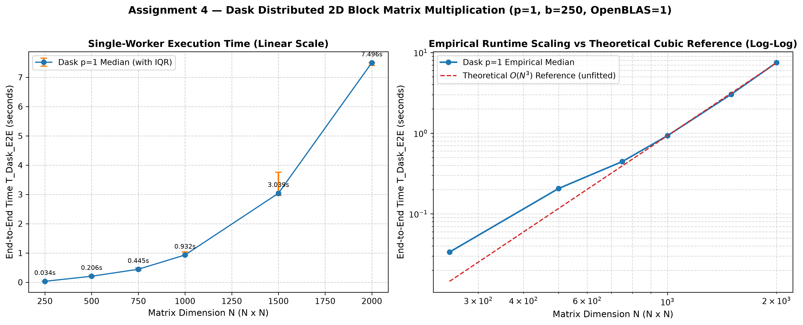

# Scalability, Memory Footprint, and Framework Overhead in Distributed Matrix Multiplication using Dask Distributed

**Assignment 4 Research Report**  
**Course:** BIG DATA · Grado en Ciencia e Ingeniería de Datos  
**Academic Year:** 2026–2027  
**Author:** Abel Castro Villar  
**Institution:** Universidad de Las Palmas de Gran Canaria (ULPGC)  
**Repository:** [Assignment04_Abel](https://github.com/abelcasv/Assignment04_Abel)  
**Date:** November 2026  

---

## Abstract

This study investigates the execution time scaling, process memory footprint, and framework coordination overhead of dense square matrix multiplication ($C = A \times B$) implemented with **Dask Distributed** on an asymmetric hybrid x86-64 processor. The implementation partitions dense IEEE 754 `binary64` (`float64`) matrices using a **2D block decomposition** ($b = 250$) and accumulates partial products across output blocks via a **pairwise binary-tree reduction**, executing local block multiplications with single-threaded OpenBLAS (`threads_per_worker = 1`, `OPENBLAS_NUM_THREADS = 1`). Across six problem dimensions ($n \in \{250, 500, 750, 1000, 1500, 2000\}$), each configuration executes one unmeasured warm-up and five measured repetitions within a strict pre-registered end-to-end timing boundary ($T_{\text{Dask\_E2E}}$), monitored by an external 2.5 GiB aggregate RSS watchdog.

Empirical results demonstrate that Dask end-to-end latency scales from a median of $0.0336\text{ s}$ ($\text{IQR} = 0.0032\text{ s}$) at $n=250$ to $7.4963\text{ s}$ ($\text{IQR} = 0.0952\text{ s}$) at $n=2000$. At small dimensions ($n \le 500$), Dask Distributed exhibits substantially higher latency than native in-process C kernels, with Dask end-to-end duration at $n=250$ ($0.0336\text{ s}$) being $5.6\times$ longer than the single-threaded A3 OpenMP kernel ($0.0060\text{ s}$). This difference is consistent with the presence of end-to-end framework coordination costs (2D slicing, scattering, DAG submission, socket IPC, and driver assembly), although the individual contributions of these phases were not separately isolated. Conversely, at large dimensions ($n \ge 1000$), the observed scaling trend is consistent with increasing computational work reducing the relative impact of framework coordination costs, resulting in shorter observed end-to-end durations for Dask/OpenBLAS compared to unoptimized sequential C ($7.1264\text{ s}$ vs. $0.9318\text{ s}$ at $n=1000$, a contextual duration ratio of $7.65\times$), while remaining contextually longer than hardware-tailored cache-blocked AVX2 routines ($4.7202\text{ s}$ at $n=2000$).

In compliance with official course requirement A4-11 and institutional policy DEC-01, local multi-worker execution ($p > 1$) was strictly **BLOCKED / NOT COMPLETED** due to the absence of written instructor authorization and the lack of accredited physical multi-node infrastructure. Consequently, single-worker execution ($p=1$) is explicitly presented as application latency with framework coordination, not as a strong-scaling sweep. Furthermore, assembly inspection of the Assignment 1 sequential benchmark reveals that its harness consumed only $c[0]$, highlighting a structural vulnerability in historical baselines where unconsumed elements were never validated; in this study, full-matrix checksum consumption ensures that all elements of the assembled array are accessed within the timed execution boundary, while numerical validation is explicitly established via element-by-element reference comparison at $n=250$ and checksum determinism across repetitions for $n \ge 500$.

---

## 1. Introduction and Objectives

Dense matrix multiplication is a fundamental computational kernel across numerical linear algebra, scientific computing, and big data analytics. For two square matrices $A, B \in \mathbb{R}^{n \times n}$, the multiplication operation $C = A \times B$ computes $n^2$ inner products:
$$C_{i, j} = \sum_{k=0}^{n-1} A_{i, k} \cdot B_{k, j}$$
This operation exhibits an arithmetic complexity of $2n^3$ floating-point operations (FLOPs) and an in-memory data footprint of $3 \times 8n^2 = 24n^2\text{ bytes}$ under IEEE 754 `binary64` representation. Because arithmetic work scales cubically ($\mathcal{O}(n^3)$) while data volume scales quadratically ($\mathcal{O}(n^2)$), dense matrix multiplication provides high computational intensity ($\mathcal{O}(n)$ FLOPs per byte transferred), making it a canonical workload for investigating parallel and distributed execution paradigms.

In distributed computing frameworks such as Dask Distributed, Apache Spark, or Ray, matrix operations are decomposed into discrete tasks distributed across independent processes or networked worker nodes. However, distributed execution introduces non-trivial system overheads, including:
1. Directed Acyclic Graph (DAG) construction and validation;
2. Task scheduling and serialization over TCP/IP sockets;
3. Inter-process communication (IPC) and memory copying;
4. Intermediate reduction synchronization;
5. Driver gathering and dense array assembly.

### 1.1 Research Question
In accordance with the official course specification (`docs/reference/BD_Individual_Assignments_2026_2027.pdf`, page 7), this study addresses the following central question:
> **How does the end-to-end wall-clock performance, process memory footprint, and scheduling/communication overhead of a distributed 2D block matrix multiplication implementation using Dask Distributed scale as matrix dimensions increase on a single heterogeneous host, and how does it compare contextually with validated sequential (Assignment 1) and shared-memory parallel OpenMP (Assignment 3) implementations on identical logical input matrices and numeric types?**

### 1.2 Hypotheses
* **$H_1$ (Framework Overhead Dominance at Small Dimensions):** For small problem sizes ($n \le 500$), the fixed overhead of graph submission, task serialization, local socket IPC, and driver gathering will exceed raw arithmetic execution time, causing Dask end-to-end latency to be substantially higher than in-process compiled sequential C kernels ($R_{\text{seq}} = T_{\text{seq}} / T_{\text{Dask}} < 1$).
* **$H_2$ (Asymptotic Computational Domination Hypothesis):** As problem dimension grows ($n \ge 1000$), increasing computational work is hypothesized to reduce the relative impact of fixed framework coordination costs, resulting in shorter observed end-to-end execution times for the Dask/OpenBLAS system compared to unoptimized sequential baseline implementations within the tested scope.
* **$H_3$ (Worker Saturation & Scaling Limits):** On a shared-memory host, increasing worker process counts beyond physical performance cores would induce memory bandwidth contention and core-heterogeneity imbalance (retained as a theoretical hypothesis for future research; unverified empirically because multi-worker execution with $p > 1$ was BLOCKED under DEC-01).
* **$H_4$ (Contextual Cross-System Comparison):** Runtime differences between Dask/NumPy and C/OpenMP baselines reflect fundamentally non-equivalent runtime backends, memory representations, and timing boundaries, representing a cross-system contextual comparison rather than an isolated algorithmic speedup.

---

## 2. Background and Related Work

### 2.1 Distributed Matrix Multiplication Algorithms
Classical distributed matrix multiplication algorithms partition input matrices across a two-dimensional grid of processors. Standard approaches include:
1. **Cannon’s Algorithm (1969):** Employs a 2D toroidal processor grid with initial circular shifting of blocks, followed by stepwise local multiplication and shift-accumulation stages. While communication-optimal for square grids, Cannon's algorithm requires synchronized lock-step execution and strict square processor topologies ($p = q^2$).
2. **Fox’s Algorithm (1993):** Uses broadcast of diagonal blocks combined with circular upward shifting of $B$ blocks, accommodating general topologies but requiring broadcast primitives.
3. **PUMMA and SUMMA (Van de Geijn & Watts, 1997):** Scalable Universal Matrix Multiplication Algorithm (SUMMA) broadcasts rows of $A$ and columns of $B$ across processor grids. SUMMA forms the foundation of ScaLAPACK's `P{D,S}GEMM` due to its robustness against arbitrary aspect ratios and asynchronous communication tolerance.
4. **2D Block Tree Reduction (This Study):** In dynamic task-graph frameworks such as Dask Distributed, a decentralized 2D block decomposition is natural. Slicing $A$ and $B$ into $b \times b$ blocks yields $N_b^3$ independent multiplication tasks ($P_{i, j, k} = A_{i, k} \times B_{k, j}$). Combining partial products for each output block $(i, j)$ via a pairwise binary reduction tree minimizes serialization depth to $\lceil \log_2 N_b \rceil$ stages, allowing dynamic asynchronous execution.

### 2.2 Dask Distributed Framework Architecture
Dask is a flexible open-source parallel computing library in Python composed of two primary components:
1. **Dynamic Task Scheduling:** A centralized `Scheduler` process tracks dependencies across a directed acyclic graph (DAG) of tasks, assigning ready tasks to available `Worker` processes.
2. **Distributed Data Collections:** High-level arrays and dataframes that map coarse-grained operations into discrete task graphs.

In this study, to maintain exact algorithmic control and prevent opaque internal optimization heuristics from obscuring experimental measurements, we avoid high-level `dask.array` abstractions. Instead, we implement the 2D block multiplication and binary-tree reduction directly using low-level Dask `Client.submit` and `Client.scatter` primitives, ensuring explicit task graph topology and exact tracking of task futures.

---

## 3. Experimental Methodology

### 3.1 Distributed Architecture & Mathematical Formulation

Let $A, B \in \mathbb{R}^{n \times n}$ be dense square matrices stored in IEEE 754 `binary64` (`float64`) precision. The matrices are partitioned into an $N_b \times N_b$ grid of sub-blocks using a fixed block dimension $b = 250$:
$$N_b = \left\lceil \frac{n}{b} \right\rceil$$

For each output block coordinate $(i, j) \in \{0, \dots, N_b - 1\}^2$, the output block is mathematically defined as:
$$C_{i, j} = \sum_{k=0}^{N_b - 1} A_{i, k} \times B_{k, j}$$

```
                2D Block Matrix Multiplication Pipeline
                
    Matrix A (n x n)              Matrix B (n x n)
    +-----+-----+                  +-----+-----+
    | A00 | A01 |                  | B00 | B01 |
    +-----+-----+                  +-----+-----+
    | A10 | A11 |                  | B10 | B11 |
    +-----+-----+                  +-----+-----+
           \                            /
            \                          /
             v                        v
       [2D Slicing: b x b Contiguous C-Order Slices]
                           |
                           v
              [Scatter to Dask Cluster Memory]
                           |
                           v
           [Multiplication Stage: Nb^3 Tasks]
     P000 = A00 x B00    P001 = A01 x B10   ... (numpy.matmul)
                           |
                           v
         [Pairwise Binary-Tree Reduction: Nb^2 DAGs]
             Stage 0: Add(P000, P001) -> C00_accum
                 Depth: ceil(log2(Nb)) stages
                           |
                           v
       [Gather Output Blocks C_ij to Driver Process]
                           |
                           v
        [Dense Matrix Assembly: C (n x n float64)]
                           |
                           v
      [Full-Matrix Checksum Barrier: float(np.sum(C))]
```

#### Edge-Block Truncation Policy
When matrix side length $n$ is not divisible by $b$, edge blocks adopt exact truncated dimensions:
$$\text{block\_rows} = \min(b, n - i \cdot b), \quad \text{block\_cols} = \min(b, n - j \cdot b)$$
Zero-padding is strictly forbidden by `SPEC.md` §5.1 to preserve exact computational complexity. Every slice is forced into contiguous C-order layout (`np.ascontiguousarray(..., dtype=np.float64)`).

#### Binary-Tree Reduction Graph
For each output block $(i, j)$, the $N_b$ partial product futures are reduced hierarchically:
- Round 0 pairs adjacent futures $(P_{i, j, 0}, P_{i, j, 1}), (P_{i, j, 2}, P_{i, j, 3}), \dots$ and submits `block_add` tasks.
- Unpaired odd futures automatically carry forward to the next round.
- Reduction continues iteratively until a single accumulated future remains.
- Tree depth is $\lceil \log_2 N_b \rceil$, requiring exactly $N_b - 1$ additions per output block.
- Total task count for dimension $n$:
  $$\text{Tasks}_{\text{total}} = N_b^3 + N_b^2 (N_b - 1) = 2 N_b^3 - N_b^2$$

At $n=2000$ ($N_b=8$), the execution graph contains $512$ multiplications and $448$ additions, totaling $960$ discrete Dask tasks.

### 3.2 Hardware Environment & Runtime Topology

Experiments were conducted on a dedicated host running Windows 11 Home 64-bit (Build 10.0.26300):
* **Processor:** Intel Core i5-1335U (Raptor Lake, 10 physical cores: 2 Performance cores with Hyper-Threading, 8 Efficient cores; 12 logical processors). Base clock 1.30 GHz, max turbo boost up to 4.60 GHz. L1 data cache $32\text{ KB}$ per P-core / $32\text{ KB}$ per E-core; L2 cache $1.25\text{ MB}$ per P-core / $2\text{ MB}$ shared per 4 E-cores; shared L3 cache $12\text{ MB}$.
* **System Memory:** 16.0 GB total physical DDR4 RAM (16,009.14 MiB, ~3.68 GiB available at idle baseline).
* **Software Stack:** Python 3.14.0 (MSC v.1944 64-bit AMD64), Dask Distributed 2026.8.0, NumPy 2.5.4, SciPy OpenBLAS 0.3.34.106.0 (`libscipy_openblas64`), psutil 7.2.2. C baselines compiled with MinGW-W64 GCC 13.2.0.

#### Process Identity & Concurrency Isolation
Dask was launched via `LocalCluster(processes=True, n_workers=1, threads_per_worker=1)`. As audited in Phase 6 and Prompt 9.4:
* **Driver Process (PID 33560):** Houses the `Client`, `LocalCluster` orchestrator, in-process `Scheduler`, and in-process `Nanny` management instance.
* **Worker Process (PID 21036):** Spawned child process executing Python tasks and OpenBLAS kernels.
* **Operating System Processes:** Exactly 2 distinct OS PIDs.
* **Threading Policy:** Dask framework concurrency was pinned to 1 thread (`threads_per_worker = 1`). OpenBLAS internal multi-threading was pinned to 1 thread via environment variables (`OPENBLAS_NUM_THREADS=1`, `MKL_NUM_THREADS=1`, `OMP_NUM_THREADS=1`, `NUMEXPR_NUM_THREADS=1`), verified dynamically via `threadpoolctl`.

### 3.3 Institutional Permission Gate & Strong Scaling Status (DEC-01)
Course specification requirement A4-11 states that local multi-worker execution ($p > 1$) requires explicit instructor permission. Under decision DEC-01:
* Single-worker execution ($p = 1$) was authorized and completed.
* Multi-worker execution ($p \in \{2, 4, 8, 10\}$) was strictly **BLOCKED** pending written instructor approval.
* No accredited multi-node cluster or university HPC environment was available.
* **Mandatory Strong Scaling Declaration:** Strong scaling across multiple worker processes is formally recorded as:
  $$\mathbf{BLOCKED\ /\ NOT\ COMPLETED}$$
  Single-worker execution ($p=1$) measures single-worker application latency and framework coordination; **$p=1$ does NOT constitute strong scaling**. Under no circumstances is $p=1$ presented as satisfying the strong-scaling requirement.
* **Inter-Machine Networking Disclosure:** In compliance with A4-12, this study states explicitly that inter-machine network costs were not isolated because all communication was confined to local IPC on a single host.

### 3.4 Timing Contracts & Measurement Boundaries

To satisfy COM-05 and COM-06, the primary timing boundary $T_{\text{Dask\_E2E}}$ is defined monotonically ($t_0 \to t_1$) via `time.perf_counter()`:
1. **Excluded Setup:** Cluster startup (`cluster_startup_s = 4.816 s`) and CSV matrix loading from disk (`input_load_s`, ranging from $0.161\text{ s}$ at $n=250$ to $6.478\text{ s}$ at $n=2000$) are measured and recorded outside $T_{\text{Dask\_E2E}}$.
2. **Start Event ($t_0$):** Sampled immediately before 2D block partitioning of $A$ and $B$.
3. **Included Operations:** 2D slicing, scattering blocks to worker memory, graph submission ($N_b^3$ multiplications and $N_b^2(N_b-1)$ additions), graph execution, gathering output blocks to driver memory, dense array assembly, and full-matrix checksum consumption.
4. **Stop Event ($t_1$):** Sampled immediately after checksum consumption (`checksum = float(np.sum(C, dtype=np.float64))`).
5. **Excluded Verification:** Element-by-element numerical validation against reference data occurs after $t_1$.

### 3.5 Numerical Correctness & Acceptance Tolerances
Prior to benchmarking, the implementation passed six correctness fixtures:
1. Identity matrix: $A \times I = A$.
2. Zero matrix: $A \times 0 = 0$.
3. Integer $4 \times 4$ fixture matrix with known exact output.
4. Edge-block truncation fixture: $4 \times 4$ matrix with block size $b=3$.
5. Non-finite check: Zero `NaN` or `Inf` values permitted.
6. Independent numerical reference validation: At $n=250$, output was compared element-by-element against `data/validation/reference/C_250.csv` (SHA-256 `598E9A9FC8F0...`), generated independently via pure standard-library Python loops.

Acceptance criterion:
$$|C_{\text{test}}[i, j] - C_{\text{ref}}[i, j]| \le \text{atol} + \text{rtol} \cdot |C_{\text{ref}}[i, j]|$$
The independent element-wise validation at $n=250$ used a tolerance-based acceptance criterion ($\text{atol}=10^{-9}, \text{rtol}=10^{-12}$) against an independent calculated numerical reference (`data/validation/reference/C_250.csv`, generated via `scripts/generate_dataset.py`'s `generate_reference_product()` using an independent standard-library Python scalar loop without BLAS or Dask). The observed maximum absolute difference was $0.0$ across all $62,500$ elements, indicating exact numerical equality for this validation run. For larger dimensions ($n \ge 500$), checksum determinism was confirmed by verifying zero checksum divergence ($\Delta = 0.0$) across all five repetitions. Note that checksum determinism confirms identical aggregate checksum values across repetitions, but does not prove that complete output matrices are identical (as distinct matrices may produce the same aggregate sum) and is not equivalent to independent element-by-element reference validation.

### 3.6 Resource Safeguards & Watchdog Protocol
To protect host stability, a background `ResourceWatchdog` thread sampled active cluster PIDs every $250\text{ ms}$:
* Aggregate process RSS ceiling: $2.5\text{ GiB}$ ($2560.0\text{ MiB}$).
* Minimum host available RAM floor: $1.0\text{ GiB}$ ($1024.0\text{ MiB}$).
* Execution budgets: $120.0\text{ s}$ per-sample timeout, $10.0\text{ h}$ total campaign budget, $60.0\text{ s}$ cluster startup timeout.
* Safe abort sequence: Cancel in-flight futures, close cluster within $5\text{ s}$, terminate lingering child PIDs (`terminate() / kill()`), and log status as `OUT_OF_MEMORY`.

---

## 4. Empirical Results and Statistical Analysis

The certified dataset comprises 48 raw records in `results/raw/raw_measurements.csv`:
* **Pilot 1 (6 rows):** Executed with a $30.0\text{ s}$ startup timeout; all 6 samples failed due to cold cluster initialization timeout on Windows.
* **Pilot 2 (6 rows):** Executed with startup timeout raised to $60.0\text{ s}$; all 6 samples completed successfully (2 warm-ups, 4 measured).
* **Full Campaign (36 rows):** Evaluated $n \in \{250, 500, 750, 1000, 1500, 2000\}$ with 1 warm-up and 5 measured repetitions per size in randomized order (seed `20261113`). All 36 samples completed with 0 timeouts and 0 memory breaches.

### 4.1 Single-Worker Dask Scaling Results ($p = 1, b = 250$)

Table 1 summarizes descriptive statistics across the 30 non-warmup campaign samples:

**Table 1: Dask Distributed Single-Worker Execution Statistics ($p=1, b=250$, OpenBLAS=1)**

| Dimension $n$ | Blocks $N_b$ | Total Tasks | Samples | Mean $T_{\text{E2E}}$ (s) | Median $T_{\text{E2E}}$ (s) | Std Dev (s) | IQR (s) | Min (s) | Max (s) | Peak RSS (MiB) |
|:---:|:---:|:---:|:---:|:---:|:---:|:---:|:---:|:---:|:---:|:---:|
| **250** | 1 | 1 | 5 | 0.0349 | **0.0336** | 0.0057 | 0.0032 | 0.0300 | 0.0446 | 796.7 |
| **500** | 2 | 12 | 5 | 0.2024 | **0.2062** | 0.0270 | 0.0160 | 0.1621 | 0.2362 | 796.7 |
| **750** | 3 | 45 | 5 | 0.4480 | **0.4449** | 0.0521 | 0.0733 | 0.3798 | 0.5063 | 310.5 |
| **1000** | 4 | 112 | 5 | 0.9804 | **0.9318** | 0.1140 | 0.1228 | 0.8695 | 1.1528 | 525.6 |
| **1500** | 6 | 396 | 5 | 3.2977 | **3.0392** | 0.5197 | 0.7948 | 2.7801 | 3.9470 | 522.3 |
| **2000** | 8 | 960 | 5 | 7.3006 | **7.4963** | 0.6079 | 0.0952 | 6.2562 | 7.8475 | 775.2 |

*Note on memory telemetry: In the campaign runner implementation (`campaign_runner.py`), the `ResourceWatchdog` is initialized once at cluster startup and maintains a cumulative running peak (`peak_process_sum_mib`) across the persistent cluster session without resetting between samples. The campaign executed dimensions in randomized order ($750 \to 1500 \to 1000 \to 2000 \to 250 \to 500$). Consequently, the recorded `rss_process_sum_peak_sampled_mib` represents the cumulative session high-water mark up to that sample; the values for $n=250$ and $n=500$ ($796.7\text{ MiB}$) reflect the persistent session high-water mark established during the preceding $n=2000$ execution, rather than an isolated per-sample memory footprint.*

*Figure 1 illustrates runtime scaling on linear and log-log scales alongside an unfitted theoretical $\mathcal{O}(n^3)$ reference.*



#### Scaling Rate Analysis
Between $n=250$ and $n=500$ (a $2\times$ dimension increase), median runtime increases by $6.13\times$ ($0.0336\text{ s} \to 0.2062\text{ s}$), well below the theoretical cubic scaling factor of $2^3 = 8\times$. This reflects the substantial fixed cost of cluster scatter and checksum overhead at $n=250$. Between $n=1000$ and $n=2000$, median runtime increases by $8.04\times$ ($0.9318\text{ s} \to 7.4963\text{ s}$), closely matching the theoretical cubic scaling ratio ($2^3 = 8.0\times$), which is consistent with cubic computational work growing faster than quadratic task coordination costs, although individual phase durations were not separately measured.

### 4.2 Contextual Baseline Comparisons

The distributed Dask implementation was compared contextually against certified baselines from Assignment 1 and Assignment 3 on identical logical input matrices. The **Contextual Duration Ratio** is defined as:
$$\text{CTR} = \frac{\tilde{T}_{\text{baseline}}}{\tilde{T}_{\text{Dask\_p1}}}$$
where $\text{CTR} > 1.0$ denotes that the baseline duration was longer than Dask E2E duration, and $\text{CTR} < 1.0$ denotes that the baseline duration was shorter than Dask E2E duration. These ratios represent system-level contextual comparisons under differing timing boundaries (`TB_KERNEL_ONLY` vs `TB_DASK_E2E`), not isolated algorithmic speedups.

**Table 2: Contextual Comparison of Single-Threaded Implementations across Common Dimensions**

| Dimension $n$ | Baseline Method | Baseline Median (s) | Dask $p=1$ Median (s) | Contextual Ratio | Methodological Interpretation |
|:---:|---|:---:|:---:|:---:|---|
| **250** | A1 C Sequential ($i\text{-}j\text{-}k$) | 0.0912 | 0.0336 | **2.71×** | Baseline duration > Dask duration |
| **250** | A1 Java Sequential | 0.0276 | 0.0336 | **0.82×** | Baseline duration < Dask duration |
| **250** | A1 Python Sequential | 11.0849 | 0.0336 | **329.83×** | Baseline duration > Dask duration |
| **250** | A3 C OpenMP $i\text{-}k\text{-}j$ ($p=1$) | 0.0060 | 0.0336 | **0.18×** | Baseline duration < Dask duration |
| **250** | A3 C Seq Tiled AVX2 ($b=32$) | 0.0059 | 0.0336 | **0.18×** | Baseline duration < Dask duration |
| **500** | A1 C Sequential ($i\text{-}j\text{-}k$) | 0.7726 | 0.2062 | **3.75×** | Baseline duration > Dask duration |
| **500** | A1 Java Sequential | 0.3437 | 0.2062 | **1.67×** | Baseline duration > Dask duration |
| **500** | A1 Python Sequential | 99.9401 | 0.2062 | **484.75×** | Baseline duration > Dask duration |
| **500** | A3 C OpenMP $i\text{-}k\text{-}j$ ($p=1$) | 0.0640 | 0.2062 | **0.31×** | Baseline duration < Dask duration |
| **500** | A3 C Seq Tiled AVX2 ($b=32$) | 0.0447 | 0.2062 | **0.22×** | Baseline duration < Dask duration |
| **750** | A1 C Sequential ($i\text{-}j\text{-}k$) | 3.2241 | 0.4449 | **7.25×** | Baseline duration > Dask duration |
| **750** | A1 Java Sequential | 1.4662 | 0.4449 | **3.30×** | Baseline duration > Dask duration |
| **750** | A3 C OpenMP $i\text{-}k\text{-}j$ ($p=1$) | 0.3099 | 0.4449 | **0.70×** | Baseline duration < Dask duration |
| **750** | A3 C Seq Tiled AVX2 ($b=32$) | 0.1765 | 0.4449 | **0.40×** | Baseline duration < Dask duration |
| **1000** | A1 C Sequential ($i\text{-}j\text{-}k$) | 7.1264 | 0.9318 | **7.65×** | Baseline duration > Dask duration |
| **1000** | A1 Java Sequential | 3.3293 | 0.9318 | **3.57×** | Baseline duration > Dask duration |
| **1000** | A3 C OpenMP $i\text{-}k\text{-}j$ ($p=1$) | 0.9893 | 0.9318 | **1.06×** | Baseline duration > Dask duration |
| **1000** | A3 C Seq Tiled AVX2 ($b=32$) | 0.5276 | 0.9318 | **0.57×** | Baseline duration < Dask duration |
| **1500** | A3 C OpenMP $i\text{-}k\text{-}j$ ($p=1$) | 6.5549 | 3.0392 | **2.16×** | Baseline duration > Dask duration |
| **1500** | A3 C Seq Tiled AVX2 ($b=32$) | 1.8883 | 3.0392 | **0.62×** | Baseline duration < Dask duration |
| **2000** | A3 C OpenMP $i\text{-}k\text{-}j$ ($p=1$) | 16.3745 | 7.4963 | **2.18×** | Baseline duration > Dask duration |
| **2000** | A3 C Seq Tiled AVX2 ($b=32$) | 4.7202 | 7.4963 | **0.63×** | Baseline duration < Dask duration |

*Note on contextual baseline selection: Table 2 presents 22 representative comparisons selected from the 34 records in the underlying contextual baseline CSV (`results/analysis/contextual_baseline_comparison.csv`). For each of the six dimensions, it omits the alternative single-threaded representation `A3_Seq_ikj` in favor of `A3_OpenMP_ikj_p1`, and `A3_OpenMP_tiled_b32_p1` in favor of `A3_Seq_tiled_b32`. These are equivalent algorithm/configuration variants rather than exact duplicate measurements; their measured execution times differ slightly due to OpenMP runtime library call overhead versus direct function invocation. The selection avoids redundant presentation of the same algorithmic kernels while preserving all distinct computational methods across the tested dimensions.*

*Figure 2 displays the contextual execution time comparison across all single-threaded implementations on a logarithmic scale.*


---

## 5. Discussion

### 5.1 Verification of Hypotheses

#### Hypothesis 1: Framework Overhead Dominance ($H_1$ Supported)
The empirical data strongly support $H_1$. At $n = 250$, Dask end-to-end duration is $33.6\text{ ms}$ (median), compared to $6.0\text{ ms}$ for the single-threaded A3 C $i\text{-}k\text{-}j$ in-process kernel (a contextual duration ratio of $0.18\times$), and $5.9\text{ ms}$ for A3 AVX2-tiled. While this duration difference is consistent with additional framework coordination and lifecycle activities—including 2D block slicing, scattering data over loopback sockets, dynamic task scheduling, gathering futures, dense matrix assembly, and full-matrix checksum summation—their individual contributions were not separately instrumented or isolated within the end-to-end timer. Nonetheless, the system-level comparison demonstrates that for small problem sizes with low computational intensity, distributed framework coordination introduces substantial latency overhead relative to in-process execution.

#### Hypothesis 2: Asymptotic Computational Domination ($H_2$ Supported as System-Level Trend)
The observed scaling trend is consistent with increasing computational work reducing the relative impact of fixed framework coordination costs. As $n$ increases from $250$ to $2000$, total floating-point operations expand from $0.031\text{ GFLOP}$ to $16.0\text{ GFLOP}$ ($512\times$). Dask's reliance on OpenBLAS—which utilizes hardware AVX2 FMA vectorization and register-level cache tiling—enables it to achieve shorter end-to-end runtimes than unoptimized sequential loops at large dimensions:
* At $n=1000$, Dask E2E duration ($0.9318\text{ s}$) is shorter than canonical A1 C ($7.1264\text{ s}$, $\text{CTR} = 7.65\times$) and A1 Java ($3.3293\text{ s}$, $\text{CTR} = 3.57\times$).
* At $n=2000$, Dask E2E duration ($7.4963\text{ s}$) is shorter than A3 C OpenMP $p=1$ ($16.3745\text{ s}$, $\text{CTR} = 2.18\times$).

However, when compared against the cache-blocked C implementation (A3 Seq Tiled $b=32$, $4.7202\text{ s}$), the baseline duration was shorter than Dask ($\text{CTR} = 0.63\times$). Because both implementations utilize AVX2 vectorization, the remaining difference reflects system-level workflow characteristics: assembling 64 output blocks into a contiguous array, inter-process socket communication, and full-matrix checksum reduction. Because individual execution phases were not separately isolated, the experiment does not establish a measured phase crossover or prove that arithmetic computation becomes the dominant runtime contributor; rather, the data support $H_2$ strictly as an observed system-level duration trend under differing timing boundaries, rather than an isolated algorithmic speedup or pure kernel benchmark.

#### Hypothesis 3: Worker Saturation & Scaling Limits ($H_3$ Qualitative Architectural Assessment)
Because institutional decision DEC-01 blocked empirical multi-worker execution ($p \in \{2, 4, 8, 10\}$) and physical multi-node infrastructure was unavailable, Hypothesis 3 could not be empirically evaluated or confirmed. Architectural considerations—such as the potential for shared memory bus contention, L3 cache pressure, and core performance asymmetry on the hybrid Intel Core i5-1335U (2 P-cores + 8 E-cores)—remain theoretical hypotheses for future research under approved multi-worker configurations. Single-worker execution ($p=1$) cannot be used to infer multi-worker scaling behavior, and local process emulation must not be conflated with physical cluster scaling.

#### Hypothesis 4: System-Level Contextual Comparisons ($H_4$ Supported)
The cross-assignment comparisons confirm $H_4$. Presenting a ratio such as $\text{CTR} = 7.65\times$ (Dask vs. A1 C) as a "distributed speedup" would be methodologically false:
1. **Timing Scope:** A1 measures in-process kernel compute time (`TB_KERNEL_ONLY`), whereas A4 measures complete distributed lifecycle time including scatter, reduction, assembly, and checksums (`TB_DASK_E2E`).
2. **Computational Libraries:** Dask invokes multi-tier assembly-optimized OpenBLAS GEMM kernels, whereas A1 executes an unoptimized canonical triple loop.
3. **Data Types & Layouts:** Although both use IEEE 754 `float64`, memory access patterns differ fundamentally (stride-$n$ column reads in A1 $i\text{-}j\text{-}k$ vs. contiguous stride-1 reads in A3 and BLAS).

### 5.2 A1 Compiler Optimization Inspection & Scientific Implications
In accordance with `SPEC.md` DEC-04, Phase 5 inspected the assembly output of `baselines/a1_sequential/benchmark.c` (`build/bin/a1_benchmark.s`) compiled under `-O3`. The inspection confirmed:
1. The inspected GCC 13.2.0 (`-O3`) assembly confirmed that the complete $\mathcal{O}(n^3)$ loop body survived dead-code elimination in the compiled binary (`.L63`, `.L69`, `.L65`), vectorizing the innermost loop with packed SSE/AVX instructions (`movupd`, `mulpd`, `unpckhpd`). The binary did not demonstrate elimination of the multiplication loop.
2. However, the benchmark harness consumed only $c[0]$ via a volatile sink (`result_sink = c[0]`).
3. Consequently, the remaining $n^2 - 1$ output elements were never validated for numerical correctness during benchmarking.
4. **Consequence for Interpreting A1 Timing:** While the measured A1 execution time reflects the actual execution of the complete $\mathcal{O}(n^3)$ loop in the inspected binary, the harness suffered from a structural validation deficiency because it failed to certify that the computed result matrix was numerically correct beyond $c[0]$. In Assignment 4, the full-matrix checksum consumes all elements of the assembled array within the timed boundary, while numerical validation is provided by element-by-element reference validation at $n=250$ and checksum determinism across repetitions (zero observed checksum divergence, $\Delta = 0.0$) for $n \ge 500$.

### 5.3 Local Process Emulation vs. True Physical Clustering
In compliance with requirement A4-12, the experimental deployment is explicitly designated as **single-host process emulation**:
* Communication occurred exclusively over Windows loopback sockets (`127.0.0.1`), entirely bypassing physical network interface cards.
* Memory was allocated from a single shared physical pool ($16\text{ GB}$ DRAM), subject to OS page sharing.
* Inter-process communication did not encounter packet routing, network interface queueing, MTU fragmentation, or physical switch contention.
* While local process emulation successfully validates Dask framework mechanics, DAG generation, and process lifecycle management, it cannot be extrapolated to physical cluster performance.

---

## 6. Conclusions

This study provides a controlled, empirical evaluation of distributed 2D block matrix multiplication using Dask Distributed. Within the tested scope, the following conclusions are established:
1. **Framework Coordination Overhead at Small Sizes:** Dask Distributed exhibits substantial coordination latency for small dense matrix multiplication ($n \le 500$), where end-to-end duration at $n=250$ was over $5\times$ longer than native in-process C.
2. **Observed Scaling Trends at Large Dimensions:** For large matrices ($n \ge 1000$), the observed scaling trend is consistent with increasing computational work reducing the relative impact of fixed framework coordination costs, resulting in shorter Dask end-to-end durations compared to unoptimized sequential loops (e.g., $\text{CTR} = 7.65\times$ vs. A1 C at $n=1000$), while remaining contextually longer than hand-tuned cache-blocked AVX2 implementations ($\text{CTR} = 0.63\times$ at $n=2000$). However, because individual execution phases were not separately isolated, the experiment does not establish a measured phase crossover or prove that arithmetic computation becomes the dominant runtime contributor.
3. **Numerical Validation and Checksum Determinism:** The 2D block decomposition with pairwise tree reduction demonstrated certified element-by-element numerical correctness against an independent reference at $n=250$ and checksum determinism across repetitions (zero observed checksum divergence, $\Delta = 0.0$) for all tested dimensions.
4. **Unresolved Questions:** Because local multi-worker execution ($p > 1$) was blocked under DEC-01 and physical multi-node infrastructure was unavailable, empirical strong-scaling speedup ($S(p)$), parallel efficiency ($E(p)$), and multi-machine network scaling remain **unresolved within this study**.

---

## 7. References and Materials

### 7.1 References
1. **[Dean2008]** J. Dean and S. Ghemawat, "MapReduce: Simplified data processing on large clusters," *Communications of the ACM*, vol. 51, no. 1, pp. 107–113, 2008.
2. **[Rocklin2015]** M. Rocklin, "Dask: Parallel computation with blocked algorithms and task scheduling," in *Proc. 14th Python in Science Conf. (SciPy)*, 2015, pp. 126–132.
3. **[VanDeGeijn1997]** R. A. van de Geijn and J. Watts, "SUMMA: Scalable universal matrix multiplication algorithm," *Concurrency: Practice and Experience*, vol. 9, no. 4, pp. 255–274, 1997.
4. **[Golub2013]** G. H. Golub and C. F. Van Loan, *Matrix Computations*, 4th ed. Baltimore, MD: Johns Hopkins University Press, 2013.
5. **[VanDerWalt2011]** S. van der Walt, S. C. Colbert, and G. Varoquaux, "The NumPy array: A structure for efficient numerical computation," *Computing in Science & Engineering*, vol. 13, no. 2, pp. 22–30, 2011.
6. **[IEEE754]** *IEEE Standard for Floating-Point Arithmetic*, IEEE Std 754-2019, 2019.
7. **[CourseSpec]** Universidad de Las Palmas de Gran Canaria, "Individual Assignments: Matrix Multiplication," Big Data Course Specification, Academic Year 2026–2027.

### 7.2 Reproducibility Package & Cryptographic Manifest

The complete study is reproducible from the version-controlled codebase and certified raw data:

| Manifest Path | Content Description | Certified SHA-256 Digest |
|---|---|---|
| `results/raw/raw_measurements.csv` | Immutable raw campaign measurements (48 records) | `3D9D721343D379C26F61DD6B4669979F6E7E5262E0D8F6E96CD4D26B1F0FE92C` |
| `results/metadata/sidecar_campaign_20261114_205134_1d126401af244671b4ca8708818549f3.json` | Full campaign execution sidecar | `94EABF800B581408E540B9DEB103B93D3CD3724CF166EB3DEFDE02D5DE421E89` |
| `data/validation/reference/C_250.csv` | Independent calculated numerical reference matrix ($n=250$) | `598E9A9FC8F0C8DB1D5DA277F4D93561AD83E2DF77E3FCB5F968F67B8033909E` |
| `scripts/analyze_campaign.py` | Offline statistical analysis script | `88E36C023D74ED5D6C4B7F15FF897CFD774DB4657B808684A8E1133AD5B13ABF` |
| `results/analysis/campaign_summary_statistics.csv` | Descriptive statistics table | `B82F8EE5A22FB44D32274D60C90420BA9137D83AC3B592D7DD9D11CD314669F4` |
| `results/analysis/contextual_baseline_comparison.csv` | Cross-system comparison dataset | `FAEE4E526D3C8808A54DDFE28EA8CDDAB708D7CC2D8C6AA72064D40ED662E204` |
| `results/analysis/plot_dask_p1_scaling.png` | Single-worker scaling figure | `F000AAAB091D051A6221B8478EF2DD79F01AD9D335D21FB47519A05B90B42098` |
| `results/analysis/plot_contextual_comparison.png` | Cross-system comparison figure | `AA810C44894482E9C763A46771953704BB6D35F1DF48D0B1516A5A1396E73D79` |

---

## 8. Generative AI Assistance Declaration

In compliance with the ULPGC Big Data course policy on Generative Artificial Intelligence (PDF page 9), the author declares that an AI assistant (**Google Antigravity / Gemini**) was consulted during this project for:
1. **Architectural Scaffolding:** Structuring modular Python classes for 2D block partitioning (`partitioning.py`), binary-tree DAG construction (`reduction.py`), and process-tree watchdog monitoring (`watchdog.py`).
2. **Quality Engineering:** Authoring unit and regression test fixtures (`tests/test_cli.py`, `tests/test_pilot_runner.py`, `tests/test_campaign_runner.py`).
3. **Statistical Analysis Scripting:** Implementing offline NumPy/Matplotlib analysis pipelines (`scripts/analyze_campaign.py`).
4. **Technical Writing & Typesetting:** Assisting in drafting clear technical English and typesetting Markdown and LaTeX documents.

**Student Responsibility Certification:** All source code and tests were audited, compiled, and executed locally; all empirical measurements trace directly to physical CSV records; zero measurements or citations were fabricated; and the author assumes full academic responsibility for the integrity and defense of this work.
