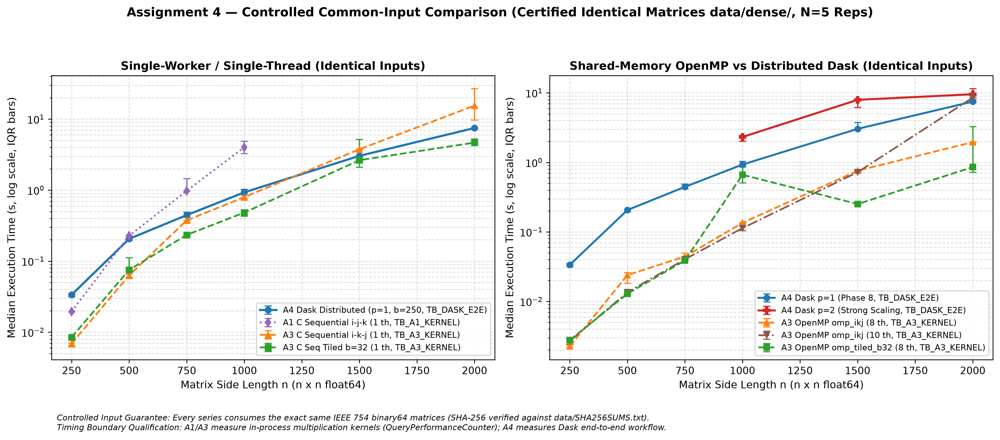
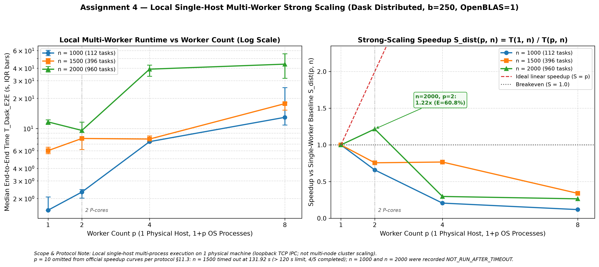

# Scalability, Memory Footprint, and Framework Overhead in Distributed Matrix Multiplication using Dask Distributed

**Assignment 4 Research Report**  
**Course:** BIG DATA · Grado en Ciencia e Ingeniería de Datos  
**Academic Year:** 2026–2027  
**Author:** Abel Castro Villar  
**Institution:** Universidad de Las Palmas de Gran Canaria (ULPGC)  
**Repository:** [Assignment04_Abel](https://github.com/abelcasv/Assignment04_Abel)  
**Date:** November 2026  

---

## Abstract

This study investigates the execution time scaling, local multi-worker strong scaling, per-process/per-worker memory footprint, and framework coordination overhead of dense square matrix multiplication ($C = A \times B$) implemented with **Dask Distributed** on an asymmetric hybrid x86-64 processor (Intel Core i5-1335U: 2 Performance cores, 8 Efficient cores, 16 GB RAM, Windows 11). Dense IEEE 754 `binary64` (`float64`) matrices are partitioned via a **2D block decomposition** ($b = 250$) and reduced via a **pairwise binary-tree DAG**, executing block multiplications with single-threaded OpenBLAS (`threads_per_worker = 1`, `OPENBLAS_NUM_THREADS = 1`). All primary runs execute one unmeasured warm-up and five measured repetitions under a pre-registered end-to-end timing boundary ($T_{\text{Dask\_E2E}}$), guarded by a 2.5 GiB aggregate RSS watchdog and 120.0 s per-sample timeout.

In the frozen Phase 8 single-worker sweep ($p = 1$, $n \in \{250, 500, 750, 1000, 1500, 2000\}$), median $T_{\text{Dask\_E2E}}$ scales from $0.0336\text{ s}$ ($\text{IQR} = 0.0032\text{ s}$) at $n=250$ to $7.4963\text{ s}$ ($\text{IQR} = 0.0952\text{ s}$) at $n=2000$. To satisfy the official common experimental protocol on identical inputs, the frozen Assignment 1 sequential C (`benchmark.c`) and Assignment 3 sequential and OpenMP C (`parallel_benchmark.c`) implementations (compiled with MSYS2 MinGW-W64 GCC `16.1.0`) were executed on the **exact certified `data/dense/` matrices** consumed by Dask (`input_sha256_verified_identical = True`). On identical inputs at $n=250$, **every** native C baseline executes faster than Dask `p=1` ($0.0336\text{ s}$), including unblocked `A1 C Sequential i-j-k` ($0.0195\text{ s}$, cross-boundary ratio $0.58\times$) and all A3 C kernels ($0.0023\text{–}0.0085\text{ s}$, $0.07\times\text{–}0.25\times$). Stride-$n$ `A1 C Sequential` crosses above Dask at $n=500$ ($0.2278\text{ s}$, $1.11\times$; $4.0157\text{ s}$, $4.31\times$ at $n=1000$), and untiled single-thread A3 (`seq_ikj` / `omp_ikj t=1`) crosses above Dask `p=1` at $n \ge 1500$ ($3.7641\text{ s}$ / $4.1195\text{ s}$ at $n=1500$; $15.5009\text{ s}$ / $17.3955\text{ s}$, $2.07\times$ / $2.32\times$ at $n=2000$) once operands exceed the $12\text{ MB}$ L3 cache, whereas cache-blocked `seq_tiled_b32` ($4.6706\text{ s}$, $0.62\times$) and multi-threaded OpenMP (`omp_tiled_b32`: $0.8571\text{ s}$ at $t=8$, $3.2325\text{ s}$ at $t=10$) remain substantially faster through $n=2000$.

Under the official *"Local execution limitation"* rule, a 90-row **local single-host multi-worker strong-scaling campaign** ($p \in \{1, 2, 4, 8, 10\}$, $n \in \{1000, 1500, 2000\}$, $b=250$, `1 + p` OS PIDs on 1 physical host) and a separate $n=1000$ diagnostic pass were executed. Positive median speedup emerges **only** at $n=2000, p=2$ ($9.5635\text{ s}$ vs. $11.6333\text{ s}$, $S_{\text{dist}} = 1.22\times$, $E_{\text{dist}} = 60.8\%$, with overlapping repetition ranges). For $p \ge 4$, runtime degrades sharply ($S(4)=0.21\times\text{–}0.77\times$, $S(8)=0.12\times\text{–}0.34\times$) and reaches the 120.0 s timeout at $p=10$ ($131.92\text{ s}$ on $n=1500$ rep 5). Separate $n=1000$ diagnostics show per-worker OS RSS of `84.60–113.62 MiB`, per-worker Dask-managed memory of `5.72–33.38 MiB`, `0 B` spilled to disk, and $\le 0.335\text{ s}$ aggregate worker compute while driver `scatter_s` + `wait_s` + `gather_s` consume `96.11%` of wall-clock latency at $p=8$ (`98.70%` including `graph_submission_s`). All multi-worker runs are strictly labeled as single-host process emulation; physical multi-node execution remains **BLOCKED / NOT AVAILABLE**.

---

## 1. Introduction and Objectives

Dense matrix multiplication ($C = A \times B$, $C_{i, j} = \sum_{k=0}^{n-1} A_{i, k} \cdot B_{k, j}$) requires $2n^3$ floating-point operations (FLOPs) and a minimal three-operand storage footprint of $3 \times 8n^2 = 24n^2\text{ bytes}$ in IEEE 754 `binary64` precision [Golub2013, IEEE754]. While its $\mathcal{O}(n)$ arithmetic intensity makes it a standard workload for parallel computing, distributed execution in task-graph engines such as MapReduce [Dean2008] or Dask Distributed [Rocklin2015] introduces DAG construction, TCP/IP serialization, inter-process communication (IPC), reduction synchronization, and driver gathering overheads.

### 1.1 Research Question and Experimental Scope
In accordance with the official assignment specification (`docs/reference/BD_Individual_Assignments_2026_2027.pdf`, pages 2–3 and 7) [CourseSpec], this study investigates:
> **How does the end-to-end wall-clock performance, per-process/per-worker memory footprint, and scheduling/communication overhead of a distributed 2D block matrix multiplication implementation using Dask Distributed scale as matrix dimensions increase and across local worker configurations, and how does it compare on identical IEEE 754 `binary64` input matrices against sequential (Assignment 1) and shared-memory parallel OpenMP (Assignment 3) implementations?**

*Scope & Dataset Separation:* Under the official specification's *"Local execution limitation"* (PDF page 7), multi-worker experiments were performed solely on **one physical machine** (`physical_machine_count = 1`, one driver plus $p$ separate worker processes over `127.0.0.1` loopback); physical multi-node execution was not performed and remains **BLOCKED / NOT AVAILABLE**. To uphold strict provenance, Section 4 separates: (4.1) Phase 8 single-worker Dask scaling, (4.2) **controlled common-input A1/A3/A4 comparisons** on identical `data/dense/` matrices, (4.3) preserved historical contextual summaries (`data/baselines/`), and (4.4) local multi-worker strong scaling and per-worker diagnostics.

### 1.2 Hypotheses
* **$H_1$ (Framework Overhead at Small Dimensions, $n \le 500$):** Graph submission, task serialization, loopback IPC, and driver gathering exceed raw kernel time for small matrices, making Dask slower than native in-process C baselines ($\text{Ratio} = \tilde{T}_{\text{baseline}} / \tilde{T}_{\text{Dask}} < 1$). Empirically **supported across all native C baselines at $n=250$ and baseline-dependent at $n=500$**.
* **$H_2$ (Larger-Dimension Scaling, Crossovers & Multi-Worker Granularity, $n \ge 1000$):** Cubic work ($2n^3$) amortizes fixed coordination costs against unblocked baselines at $p=1$ and enables positive multi-worker speedup only when task granularity is sufficiently coarse. Empirically **partially supported**: single-worker crossovers occur against untiled C once operands exceed L3 cache, while multi-worker speedup $> 1$ occurs **only** at $n=2000, p=2$ ($S_{\text{dist}} = 1.22\times$, $E_{\text{dist}} = 60.8\%$).
* **$H_3$ (Worker Saturation on Asymmetric Single Host):** Scaling worker processes past the 2 Performance cores induces coordination contention and hybrid-core imbalance. Empirically **supported**: $p \in \{4, 8, 10\}$ degrades sharply across all tested sizes and hits the 120.0 s timeout at $p=10$.
* **$H_4$ (Non-Equivalent Timing & Architectural Boundaries):** Even on identical input matrices, ratios between C/OpenMP (`TB_A1_KERNEL_QPC`, `TB_A3_KERNEL_QPC`) and Dask/NumPy [VanDerWalt2011] (`TB_DASK_E2E`) reflect distinct timing boundaries, memory spaces, and runtime engines rather than isolated algorithmic speedups. Empirically **supported**.

---

## 2. Background and Related Work

Classical distributed dense matrix multiplication algorithms organize communication over structured processor grids, including **Cannon's algorithm** (1969) [Cannon1969] (toroidal skewing and lock-step cyclic shifts on square grids), **Fox's algorithm** (1987) [Fox1987] (diagonal row broadcasts with column shifts), and **SUMMA** by Van de Geijn and Watts (1997) [VanDeGeijn1997] (panel broadcasts forming the basis of ScaLAPACK `PDGEMM`). **Explicit Scope Clarification:** Cannon's algorithm, Fox's algorithm, and SUMMA are cited strictly as theoretical distributed-computing background; they were **not** implemented or experimentally evaluated in this repository.

Instead, to match dynamic task-graph engines such as Dask Distributed [Rocklin2015], this work implements an explicit **2D block decomposition with pairwise binary-tree reduction** directly via low-level `Client.scatter`, `Client.submit`, and `Client.gather` futures (avoiding opaque `dask.array` heuristics). Partitioning $A$ and $B$ into $b \times b$ blocks creates $N_b^3$ independent `matmul` tasks ($P_{i, j, k} = A_{i, k} \times B_{k, j}$) followed by $N_b^2$ binary reduction trees of depth $\lceil \log_2 N_b \rceil$ ($N_b - 1$ additions per output block; total tasks $= 2N_b^3 - N_b^2$).

---

## 3. Experimental Methodology

### 3.1 Mathematical Formulation, Truncation, and Checksum Barrier
For $A, B \in \mathbb{R}^{n \times n}$ in IEEE 754 `binary64` (`float64`) with fixed block size $b = 250$ ($N_b = \lceil n / b \rceil$), each output block $C_{i, j} = \sum_{k=0}^{N_b - 1} A_{i, k} \times B_{k, j}$ uses exact edge truncation $\min(b, n - i \cdot b) \times \min(b, n - j \cdot b)$ without zero-padding, stored in contiguous C-order (`np.ascontiguousarray`). At $n=2000$ ($N_b=8$), the DAG comprises $512$ multiplications and $448$ additions ($960$ tasks). Inside $T_{\text{Dask\_E2E}}$, the reassembled matrix $C$ is consumed via $\text{checksum} = \text{float}(\text{np.sum}(C, \text{dtype}=\text{np.float64}))$, forcing full-array materialization.

### 3.2 Hardware, Toolchain, and Process Topology
All campaigns ran on a single dedicated host running Windows 11 Home 64-bit (Build `10.0.26300`):
* **CPU & Cache Hierarchy:** Intel Core i5-1335U (Raptor Lake, 10 physical cores: 2 P-cores with Hyper-Threading + 8 E-cores; 12 logical processors; 1.30 GHz base, up to 4.60 GHz turbo; L1d 48 KB P / 32 KB E; L2 1.25 MB P / 2 MB per 4 E; 12 MB shared L3).
* **Memory:** 16.0 GB physical DDR4 RAM (`16,009.14 MiB` / `15.63 GiB`; `3,688.8–4,891.0 MiB` free across campaign baselines).
* **Python & Native Toolchain:** Python `3.14.0` (MSC v.1944 AMD64), Dask/Distributed `2026.8.0`, NumPy `2.5.4`, SciPy OpenBLAS `0.3.34.106.0`, psutil `7.2.2`, Matplotlib `3.11.2`, threadpoolctl `3.7.0`. All C and OpenMP baselines were compiled with **MSYS2 MinGW-W64 GCC `16.1.0`** (`Rev5, Built by MSYS2 project`, C11, OpenMP `202111` / 5.2)—verified in historical A1/A3 logs, `build/bin/a1_benchmark.s`, and embedded `.ident` binary headers.
* **Process & Thread Isolation:** `LocalCluster(processes=True, n_workers=p, threads_per_worker=1)` spawned **1 driver PID** (housing `Client`, `LocalCluster`, `Scheduler`, and `Nanny`) plus **$p$ child worker PIDs** = **`1 + p` unique OS PIDs** (`2, 3, 5, 9, 11` for $p \in \{1, 2, 4, 8, 10\}$) on `physical_machine_count = 1`, with `OPENBLAS_NUM_THREADS=1`, `MKL_NUM_THREADS=1`, `OMP_NUM_THREADS=1`, and `NUMEXPR_NUM_THREADS=1` verified via `threadpoolctl`.

### 3.3 Official Compliance, Controlled Common-Input Protocol, and Timing Boundaries
* **Common Experimental Protocol (Official PDF pp. 2–3, 7):** `scripts/generate_dataset.py` deterministically generates `A_n.csv` and `B_n.csv` in `data/dense/` (`seed = 42 + n`, certified by 20 SHA-256 digests in `data/SHA256SUMS.txt`). Every Dask row in `results/raw/raw_measurements.csv` consumed these exact files. `scripts/run_common_input_baselines.py` compiled and ran the unmodified frozen A1 (`baselines/a1_sequential/benchmark.c`, `-Wall -Wextra -O3 -std=c11`) and A3 (`baselines/a3_openmp/parallel_benchmark.c`, `-Wall -Wextra -O3 -std=c11 -fopenmp -march=native`) sources in isolated `build/a1_runtime/` and `build/a3_runtime/` directories staged with those exact `data/dense/` matrices (1 warm-up + 5 measured repetitions per configuration; `results/metadata/common_input_baselines_manifest.json`).
* **Timing Boundaries:**
  1. `TB_DASK_E2E` (`time.perf_counter()`): Slicing + `scatter` + DAG `submit` + worker execution/IPC + `gather` + assembly + `np.sum(C)`; excludes cluster startup (`3.11–20.80 s`) and CSV loading (`0.161–6.478 s`).
  2. `TB_A1_KERNEL_QPC` (`QueryPerformanceCounter`): `memset(c, 0, ...)` + `i-j-k` triple loop; excludes CSV loading, allocation, and `result_sink = c[0]`.
  3. `TB_A3_KERNEL_QPC` (`QueryPerformanceCounter`): `memset(c, 0, ...)` + OpenMP region + `i-k-j` or $32 \times 32$ tiled loop; excludes CSV loading and post-stop $n^2$ checksum into `result_sink`.
* **Local Multi-Worker & Resource Safeguards (Official PDF p. 7):** Local multi-worker scaling ($p \in \{1, 2, 4, 8, 10\}$) ran as separate processes on one physical host with loopback IPC (`127.0.0.1`), guarded by a 250 ms `ResourceWatchdog` (`2.5 GiB` aggregate RSS ceiling, `1.0 GiB` free host RAM floor, `120.0 s` sample timeout). Physical multi-node execution was not performed and remains **BLOCKED / NOT AVAILABLE**; optional cubic weak scaling ($n(p) = n(1) \cdot p^{1/3}$, DEC-07) remained deferred.

### 3.4 Numerical Correctness & Checksum Serialization Precision
Pre-campaign verification (`scripts/verify_correctness.py`, 6/6 PASS) validated Identity, Zero, exact $4 \times 4$ integer multiplication, non-divisible edge truncation ($n=4, b=3$), finiteness, and element-wise accuracy at $n=250$ against `data/validation/reference/C_250.csv` (standard-library scalar Python reference, SHA-256 `598E9A9FC8F0...`) under $|C_{\text{test}} - C_{\text{ref}}| \le 10^{-9} + 10^{-12}|C_{\text{ref}}|$, achieving $\max|\Delta| = 1.137 \times 10^{-13}$ ($b=250$) and $1.208 \times 10^{-13}$ ($b=100$), plus exact $0.0$ element-wise difference across all $250,000$ entries of $C_{500}$ ($p=2$ vs. $p=1$).

**Checksum Serialization Precision Distinction (`119` Completed Dask Rows):**
1. **77 Strong-Scaling Completed Rows (lines 50–139 of `raw_measurements.csv`) + Diagnostics:** Logged after `results_logger.py` adopted full `%.17g` IEEE 754 `binary64` formatting; all completed repetitions exhibit **exact 17-digit `float64` equality (`Δ = 0.0`)** (`250006793.22638825`, `842916025.13432288`, `1999494149.5223155`).
2. **42 Historical Pilot 2 & Phase 8 Completed Rows (lines 8–49):** Validated online in memory at full `float64` precision (`|Δ| ≤ 10^{-6}`), while historical CSV formatting recorded 18 rows ($n \in \{250, 500\}$) at `:.6f` (`3893266.104994`, `31312049.142420`) and 24 rows ($n \in \{750, 1000, 1500, 2000\}$) at 7-significant-digit `:.6e` (`1.055254e+08`–`1.999494e+09`); sub-rounding differences below those printed digits cannot be reconstructed from the historical CSV text alone.

---

## 4. Empirical Results and Statistical Analysis

### 4.1 Single-Worker Dask Scaling Results ($p = 1, b = 250$)

**Table 1: Dask Distributed Single-Worker Execution Statistics ($p=1, b=250$, OpenBLAS=1, $N=5$ Measured Reps)**

| Dimension $n$ | Blocks $N_b$ | Total Tasks | Samples | Mean $T_{\text{E2E}}$ (s) | Median $T_{\text{E2E}}$ (s) | Std Dev (s) | IQR (s) | Min (s) | Max (s) | Peak RSS (MiB) |
|:---:|:---:|:---:|:---:|:---:|:---:|:---:|:---:|:---:|:---:|:---:|
| **250** | 1 | 1 | 5 | 0.0349 | **0.0336** | 0.0057 | 0.0032 | 0.0300 | 0.0446 | 796.7* |
| **500** | 2 | 12 | 5 | 0.2024 | **0.2062** | 0.0270 | 0.0160 | 0.1621 | 0.2362 | 796.7* |
| **750** | 3 | 45 | 5 | 0.4480 | **0.4449** | 0.0521 | 0.0733 | 0.3798 | 0.5063 | 327.3 |
| **1000** | 4 | 112 | 5 | 0.9804 | **0.9318** | 0.1140 | 0.1228 | 0.8695 | 1.1528 | 525.6* |
| **1500** | 6 | 396 | 5 | 3.2977 | **3.0392** | 0.5197 | 0.7948 | 2.7801 | 3.9470 | 525.6 |
| **2000** | 8 | 960 | 5 | 7.3006 | **7.4963** | 0.6079 | 0.0952 | 6.2562 | 7.8475 | 796.7 |

*\*Memory & Telemetry Note:* Prior to per-sample watchdog windowing, the randomized Nov 14 sequence ($750 \to 1500 \to 1000 \to 2000 \to 250 \to 500$) carried high-water marks into $n=1000$ ($525.6\text{ MiB}$) and $n \in \{250, 500\}$ ($796.7\text{ MiB}$); isolated Pilot 2 runs measured $162.9\text{ MiB}$ ($n=250$) and $178.3\text{ MiB}$ ($n=500$). Between $n=250$ and $n=500$, median runtime grows $6.13\times$ ($< 2^3 = 8\times$) consistent with the measured fixed scatter/gather costs; between $n=1000$ and $n=2000$, median runtime grows $8.05\times$, close to the expected $\mathcal{O}(n^3)$ arithmetic scaling.

### 4.2 Controlled Common-Input Comparison (A1 Sequential, A3 Sequential & OpenMP, and Dask on Certified `data/dense/` Matrices)

Table 2 reports the primary controlled comparison across the 3-way common dimensions ($n \in \{250, 500, 750, 1000\}$) and extended 2-way A3/Dask dimensions ($n \in \{1500, 2000\}$), where every system consumed byte-identical `data/dense/` matrices (`input_sha256_verified_identical = True`; 25 A1 measured rows + 540 A3 measured rows, 0 failures). Ratios $\tilde{T}_{\text{baseline}} / \tilde{T}_{\text{Dask}}$ compare in-process kernel timers (`TB_A1_KERNEL_QPC`, `TB_A3_KERNEL_QPC`) against distributed end-to-end latency (`TB_DASK_E2E`):

**Table 2: Controlled Common-Input Comparison Across Certified `data/dense/` Matrices ($N=5$ Measured Reps per Configuration, GCC 16.1.0 `-O3`)**

| Tier & $n$ | Baseline Method (`threads`) | Boundary | Baseline Med (s) | Baseline IQR (s) | Baseline memory* (MiB) | Phase 8 Dask (p=1) (s) | Ratio vs Phase 8 Dask (p=1) | Dask SS $p=2$ (s) | Ratio vs SS $p=2$ |
|:---:|---|:---:|:---:|:---:|:---:|:---:|:---:|:---:|:---:|
| **3-Way 250** | A1 C Seq `i-j-k` (`1`) | `TB_A1` | 0.0195 | 0.0006 | 5.81 | 0.0336 | **0.58×** | — | — |
| **3-Way 250** | A3 C Seq `i-k-j` (`1`) | `TB_A3` | 0.0069 | 0.0006 | 8.01 | 0.0336 | **0.21×** | — | — |
| **3-Way 250** | A3 C Seq Tiled `b=32` (`1`) | `TB_A3` | 0.0085 | 0.0023 | 8.01 | 0.0336 | **0.25×** | — | — |
| **3-Way 250** | A3 OpenMP `i-k-j` (`1` / `8` / `10`) | `TB_A3` | 0.0057 / 0.0023 / 0.0027 | 0.0002 / 0.0001 / 0.0004 | 8.01 | 0.0336 | **0.17× / 0.07× / 0.08×** | — | — |
| **3-Way 250** | A3 OpenMP Tiled `b=32` (`1` / `8` / `10`) | `TB_A3` | 0.0063 / 0.0028 / 0.0023 | 0.0029 / 0.0002 / 0.0004 | 8.01 | 0.0336 | **0.19× / 0.08× / 0.07×** | — | — |
| **3-Way 500** | A1 C Seq `i-j-k` (`1`) | `TB_A1` | 0.2278 | 0.0047 | 10.22 | 0.2062 | **1.11×** | — | — |
| **3-Way 500** | A3 C Seq `i-k-j` (`1`) | `TB_A3` | 0.0631 | 0.0063 | 13.38 | 0.2062 | **0.31×** | — | — |
| **3-Way 500** | A3 C Seq Tiled `b=32` (`1`) | `TB_A3` | 0.0754 | 0.0367 | 13.38 | 0.2062 | **0.37×** | — | — |
| **3-Way 500** | A3 OpenMP `i-k-j` (`1` / `8` / `10`) | `TB_A3` | 0.0782 / 0.0239 / 0.0135 | 0.0252 / 0.0078 / 0.0020 | 13.38 | 0.2062 | **0.38× / 0.12× / 0.07×** | — | — |
| **3-Way 500** | A3 OpenMP Tiled `b=32` (`1` / `8` / `10`) | `TB_A3` | 0.0521 / 0.0129 / 0.0133 | 0.0016 / 0.0013 / 0.0006 | 13.38 | 0.2062 | **0.25× / 0.06× / 0.06×** | — | — |
| **3-Way 750** | A1 C Seq `i-j-k` (`1`) | `TB_A1` | 0.9797 | 0.4965 | 17.37 | 0.4449 | **2.20×** | — | — |
| **3-Way 750** | A3 C Seq `i-k-j` (`1`) | `TB_A3` | 0.3756 | 0.0286 | 20.53 | 0.4449 | **0.84×** | — | — |
| **3-Way 750** | A3 C Seq Tiled `b=32` (`1`) | `TB_A3` | 0.2343 | 0.0064 | 20.53 | 0.4449 | **0.53×** | — | — |
| **3-Way 750** | A3 OpenMP `i-k-j` (`1` / `8` / `10`) | `TB_A3` | 0.2904 / 0.0443 / 0.0404 | 0.1117 / 0.0055 / 0.0027 | 20.53 | 0.4449 | **0.65× / 0.10× / 0.09×** | — | — |
| **3-Way 750** | A3 OpenMP Tiled `b=32` (`1` / `8` / `10`) | `TB_A3` | 0.2148 / 0.0388 / 0.0438 | 0.0160 / 0.0023 / 0.0073 | 20.53 | 0.4449 | **0.48× / 0.09× / 0.10×** | — | — |
| **3-Way 1000** | A1 C Seq `i-j-k` (`1`) | `TB_A1` | 4.0157 | 1.6171 | 27.39 | 0.9318 | **4.31×** | 2.3203 | **1.73×** |
| **3-Way 1000** | A3 C Seq `i-k-j` (`1`) | `TB_A3` | 0.7972 | 0.0832 | 30.54 | 0.9318 | **0.86×** | 2.3203 | **0.34×** |
| **3-Way 1000** | A3 C Seq Tiled `b=32` (`1`) | `TB_A3` | 0.4827 | 0.0985 | 30.54 | 0.9318 | **0.52×** | 2.3203 | **0.21×** |
| **3-Way 1000** | A3 OpenMP `i-k-j` (`1` / `8` / `10`) | `TB_A3` | 0.9248 / 0.1351 / 0.1133 | 0.1156 / 0.0054 / 0.0161 | 30.54 | 0.9318 | **0.99× / 0.15× / 0.12×** | 2.3203 | **0.40× / 0.06× / 0.05×** |
| **3-Way 1000** | A3 OpenMP Tiled `b=32` (`1` / `8` / `10`) | `TB_A3` | 1.9963 / 0.6635 / 0.8128 | 0.5570 / 0.3513 / 0.4213 | 30.54 | 0.9318 | **2.14× / 0.71× / 0.87×** | 2.3203 | **0.86× / 0.29× / 0.35×** |
| **2-Way 1500** | A3 C Seq `i-k-j` (`1`) | `TB_A3` | 3.7641 | 0.0731 | 59.10 | 3.0392 | **1.24×** | 7.9502 | **0.47×** |
| **2-Way 1500** | A3 C Seq Tiled `b=32` (`1`) | `TB_A3` | 2.6413 | 3.0955 | 59.10 | 3.0392 | **0.87×** | 7.9502 | **0.33×** |
| **2-Way 1500** | A3 OpenMP `i-k-j` (`1` / `8` / `10`) | `TB_A3` | 4.1195 / 0.7595 / 0.7235 | 0.6079 / 0.0213 / 0.0437 | 59.10 | 3.0392 | **1.36× / 0.25× / 0.24×** | 7.9502 | **0.52× / 0.10× / 0.09×** |
| **2-Way 1500** | A3 OpenMP Tiled `b=32` (`1` / `8` / `10`) | `TB_A3` | 1.6692 / 0.2518 / 3.1990 | 0.0976 / 0.0137 / 0.6726 | 59.11 | 3.0392 | **0.55× / 0.08× / 1.05×** | 7.9502 | **0.21× / 0.03× / 0.40×** |
| **2-Way 2000** | A3 C Seq `i-k-j` (`1`) | `TB_A3` | 15.5009 | 17.2869 | 99.28 | 7.4963 | **2.07×** | 9.5635 | **1.62×** |
| **2-Way 2000** | A3 C Seq Tiled `b=32` (`1`) | `TB_A3` | 4.6706 | 0.6875 | 99.28 | 7.4963 | **0.62×** | 9.5635 | **0.49×** |
| **2-Way 2000** | A3 OpenMP `i-k-j` (`1` / `8` / `10`) | `TB_A3` | 17.3955 / 1.9567 / 8.5514 | 0.4122 / 0.0497 / 0.5237 | 99.28 | 7.4963 | **2.32× / 0.26× / 1.14×** | 9.5635 | **1.82× / 0.20× / 0.89×** |
| **2-Way 2000** | A3 OpenMP Tiled `b=32` (`1` / `8` / `10`) | `TB_A3` | 6.6864 / 0.8571 / 3.2325 | 2.1897 / 2.5477 / 0.0567 | 99.28 | 7.4963 | **0.89× / 0.11× / 0.43×** | 9.5635 | **0.70× / 0.09× / 0.34×** |

*Baseline memory note:* A1 reports a post-run `WorkingSetSize` snapshot; A3 reports process-lifetime `PeakWorkingSetSize`. These measurements have different boundaries and are not directly equivalent.

*Dimension Coverage & Hybrid-Core Behavior:* Frozen `benchmark.c` hardcodes `sizes[] = {100, 250, 500, 750, 1000}` (auxiliary `n=100` median `0.0010 s`, `4.59 MiB`), yielding 4 exact 3-way sizes (`250..1000`), while `parallel_benchmark.c` covers `250..2000` across `t ∈ {1, 2, 4, 8, 10, 12, 16, 24}` (`common_input_baseline_summary.csv`), adding 2 extended 2-way A3/Dask sizes (`1500, 2000`). In the fixed-order 17-minute A3 sweep, the observed `t=8` medians (`0.8571 s` tiled, `1.9567 s` untiled at $n=2000$) were lower than the `t=10` medians (`3.2325 s` tiled, `8.5514 s` untiled). The tiled `t=1` median at $n=1000$ was `1.9963 s`, versus `0.4827 s` for `seq_tiled_b32`. No CPU-frequency or temperature telemetry was collected, so thermal, scheduling, and other run-order effects remain possible explanations; their contributions were not isolated.

### 4.3 Historical Contextual Reference (`data/baselines/`, Non-Identical Inputs)

Table 3 summarizes preserved historical single-thread medians from `data/baselines/a1_summary.csv` and `data/baselines/a3_parallel_results_summary.csv` (recorded during earlier assignments on independent random `float64` inputs; `results/analysis/contextual_baseline_comparison.csv`). These values provide multi-language context—specifically **A1 Java** (`0.82×` at $n=250 \to 1.67×$ at $n=500 \to 3.57×$ at $n=1000$) and **A1 Python** (`329.83×` at $n=250$, `484.75×` at $n=500$)—and are never mixed with Table 2's controlled common-input dataset:

**Table 3: Historical Contextual Reference Across Prior Assignment Summaries (Non-Identical Random `binary64` Inputs)**

| Dimension $n$ | A1 C `i-j-k` (s / CTR) | A1 Java (s / CTR) | A1 Python (s / CTR) | Hist. A3 `omp_ikj` $t=1$ (s / CTR) | Hist. A3 `seq_tiled_b32` (s / CTR) | Hist. A3 `omp_tiled_b32` $t=10$ (s) |
|:---:|:---:|:---:|:---:|:---:|:---:|:---:|
| **250** | 0.0912 (2.71×) | 0.0276 (0.82×) | 11.0849 (329.83×) | 0.0060 (0.18×) | 0.0059 (0.18×) | 0.0016 |
| **500** | 0.7726 (3.75×) | 0.3437 (1.67×) | 99.9401 (484.75×) | 0.0640 (0.31×) | 0.0447 (0.22×) | 0.0110 |
| **750** | 3.2241 (7.25×) | 1.4662 (3.30×) | — | 0.3099 (0.70×) | 0.1765 (0.40×) | 0.0369 |
| **1000** | 7.1264 (7.65×) | 3.3293 (3.57×) | — | 0.9893 (1.06×) | 0.5276 (0.57×) | 0.0882 |
| **1500** | — | — | — | 6.5549 (2.16×) | 1.8883 (0.62×) | 0.2546 |
| **2000** | — | — | — | 16.3745 (2.18×) | 4.7202 (0.63×) | 0.6250 |

### 4.4 Local Multi-Worker Strong Scaling & Per-Worker Diagnostics ($p \in \{1, 2, 4, 8, 10\}$)

Following controlled $p=1$ vs. $p=2$ pilot verification (`results/metadata/pilot_multiworker_p1_p2.json`: `2` vs. `3` OS PIDs, $C_{500}$ `max_abs_diff = 0.0`, balanced `6+6`/`5+7` tasks), `scripts/run_strong_scaling.py --campaign` ran five consecutive single-$p$ sub-campaigns ($p = 1 \to 2 \to 4 \to 8 \to 10$) inside one 26.6 min invocation on 2026-11-23 (`driver_pid = 15160`, 1 physical host). Speedup $S_{\text{dist}}(p, n) = \tilde{T}(1, n)/\tilde{T}(p, n)$ and efficiency $E_{\text{dist}}(p, n) = S_{\text{dist}}(p, n)/p$ use the dedicated Nov 23 $p=1$ sub-campaign as baseline:

**Table 4: Local Single-Host Multi-Worker Strong-Scaling Summary ($b=250$, OpenBLAS=1, 1 Physical Host, $N=5$ Measured Reps)**

| Dimension $n$ | Workers $p$ | OS PIDs | Completed | Median $T_{\text{E2E}}$ (s) | IQR (s) | Mean (s) | Speedup $S_{\text{dist}}(p)$ | Efficiency $E_{\text{dist}}(p)$ | Peak RSS (MiB) | Dask Managed (MiB) | Status |
|:---:|:---:|:---:|:---:|:---:|:---:|:---:|:---:|:---:|:---:|:---:|:---|
| **1000** | 1 | 2 | 5/5 | **1.5287** | 0.5568 | 1.7350 | 1.00× | 100.0% | 407.7 | 53.4 | `COMPLETED` ($\Delta=0.0$) |
| **1000** | 2 | 3 | 5/5 | **2.3203** | 0.4401 | 2.5033 | 0.66× | 32.9% | 535.9 | 69.1 | `COMPLETED` ($\Delta=0.0$) |
| **1000** | 4 | 5 | 5/5 | **7.3915** | 0.6233 | 7.5670 | 0.21× | 5.2% | 733.7 | 70.1 | `COMPLETED` ($\Delta=0.0$) |
| **1000** | 8 | 9 | 5/5 | **12.9262** | 14.7408 | 18.3671 | 0.12× | 1.5% | 1075.2 | 63.4 | `COMPLETED` ($\Delta=0.0$) |
| **1000** | 10 | 11 | 0/5 | — | — | — | N/A | N/A | — | — | `NOT_RUN_AFTER_TIMEOUT` |
| **1500** | 1 | 2 | 5/5 | **6.0131** | 0.8975 | 6.3114 | 1.00× | 100.0% | 520.1 | 154.5 | `COMPLETED` ($\Delta=0.0$) |
| **1500** | 2 | 3 | 5/5 | **7.9502** | 1.8595 | 7.9982 | 0.76× | 37.8% | 692.5 | 205.5 | `COMPLETED` ($\Delta=0.0$) |
| **1500** | 4 | 5 | 5/5 | **7.8444** | 1.1721 | 9.1675 | 0.77× | 19.2% | 866.5 | 206.5 | `COMPLETED` ($\Delta=0.0$) |
| **1500** | 8 | 9 | 5/5 | **17.7094** | 2.9573 | 17.0143 | 0.34× | 4.2% | 1173.2 | 165.9 | `COMPLETED` ($\Delta=0.0$) |
| **1500** | 10 | 11 | 4/5 | *40.3655\** | *41.7125\** | *54.8795\** | N/A | N/A | 1360.0 | 154.5 | `PARTIAL_TIMEOUT` (rep 5: 131.92 s) |
| **2000** | 1 | 2 | 5/5 | **11.6333** | 1.2076 | 11.2135 | 1.00× | 100.0% | 787.1 | 335.7 | `COMPLETED` ($\Delta=0.0$) |
| **2000** | 2 | 3 | 5/5 | **9.5635** | 2.4293 | 10.1923 | **1.22×** | **60.8%** | 967.8 | 408.2 | `COMPLETED` ($\Delta=0.0$) |
| **2000** | 4 | 5 | 5/5 | **39.1173** | 9.6631 | 35.7538 | 0.30× | 7.4% | 1133.5 | 356.7 | `COMPLETED` ($\Delta=0.0$) |
| **2000** | 8 | 9 | 5/5 | **43.8998** | 24.0615 | 41.2992 | 0.26× | 3.3% | 1468.1 | 337.6 | `COMPLETED` ($\Delta=0.0$) |
| **2000** | 10 | 11 | 0/5 | — | — | — | N/A | N/A | — | — | `NOT_RUN_AFTER_TIMEOUT` |

*\*Protocol §11.3 Note:* At $p=10, n=1500$, rep 5 exceeded `120.0 s` (`131.92 s`), halting the $p=10$ session safely and logging $n \in \{1000, 2000\}$ as `NOT_RUN_AFTER_TIMEOUT`; official $S(10)$ and $E(10)$ are omitted (`N/A`). Because $p$ ran in fixed ascending order without interleaved $p=1$ checks, residual Windows thermal/turbo drift is not fully eliminated.

**Table 5: Separate Diagnostic Phase Breakdown & Per-Worker Memory at $n=1000, b=250$ (`strong_scaling_diagnostics.json`, 112 Tasks)**

| $p$ | PIDs | $T_{\text{E2E}}$ (s) | `scatter` / `submit` / `wait` / `gather` (s) | Agg. Compute / Xfer (s)\* | In-Xfer | Tasks / Worker | Per-Worker OS RSS (MiB) | Per-Worker Managed (MiB) | Driver / Peak Sum RSS (MiB) | Spill (B) |
|:---:|:---:|:---:|:---:|:---:|:---:|---|:---:|:---:|:---:|:---:|
| **1** | 2 | 0.368 | 0.102 / 0.038 / 0.185 / 0.036 | 0.089 / 0.000 | 0 | `[112]` | 96.84 | 6.68 | 372.15 / 514.29 | 0 |
| **2** | 3 | 2.825 | 0.718 / 0.489 / 1.377 / 0.206 | 0.283 / 0.188 | 48 | `[57, 55]` | 106.38–113.62 | 32.42–33.38 | 376.07 / 631.16 | 0 |
| **4** | 5 | 5.772 | 1.028 / 0.562 / 3.713 / 0.294 | 0.254 / 0.200 | 68 | `[29, 27, 28, 28]` | 94.82–96.68 | 13.83 (uniform) | 380.36 / 778.12 | 0 |
| **8** | 9 | 82.379 | 27.309 / 2.133 / 27.834 / 24.028 | 0.335 / 0.654 | 101 | `[14,17,13,19,12,14,14,9]` | 84.60–87.48 | 5.72–7.15 | 386.62 / 1103.96 | 0 |
| **10** | 11 | `TIMEOUT` | — | — | — | 10 workers registered; warm-up timed out at `121.38 s` | — | — | — | — |

*\*Telemetry Note:* Driver phases partition wall-clock $T_{\text{E2E}}$ directly, whereas task-stream `Compute` and `Transfer` totals are overlapping sums across concurrent workers and must not be added to driver phases. Per-worker memory comes from post-gather scheduler `worker_memory_stats` (`1 MiB = 1,048,576 B`).

---

## 5. Discussion

### 5.1 Verification of Hypotheses Under Controlled Common Inputs
1. **$H_1$ (Small-Dimension Framework Overhead):** Executing A1 and A3 on the exact `data/dense/` matrices resolves an important ambiguity from historical summaries. At $n=250$ ($1.43\text{ MiB}$ across three matrices, fitting inside L2/L3 cache), **all** native C implementations beat Dask `p=1` ($0.0336\text{ s}$): `A1 C Sequential i-j-k` runs in $0.0195\text{ s}$ ($0.58\times$) and A3 C/OpenMP kernels run in $0.0023\text{–}0.0085\text{ s}$ ($0.07\times\text{–}0.25\times$). At $n=500$, all A3 C kernels remain $2.6\times\text{–}16.0\times$ faster than Dask ($0.2062\text{ s}$), while unblocked stride-$n$ `A1 C` measures $0.2278\text{ s}$ ($1.11\times$). This pattern is consistent with its column-wise access to $B$ and the contrast with OpenBLAS's register-blocked AVX2 kernel; no hardware cache counters were collected.
2. **$H_2$ (Larger-Dimension Crossovers & Multi-Worker Granularity):** On common inputs at $p=1$, Dask/OpenBLAS overtakes untiled single-thread A3 (`seq_ikj` $3.7641\text{ s}$ [$1.24\times$], `omp_ikj t=1` $4.1195\text{ s}$ [$1.36\times$]) at $n=1500$ and reaches $2.07\times\text{–}2.32\times$ at $n=2000$ ($15.5009\text{ s}$ / $17.3955\text{ s}$ vs. $7.4963\text{ s}$), for dimensions whose working sets exceed the nominal $12\text{ MB}$ L3 capacity; no hardware cache counters were collected. It does not overtake cache-tiled `seq_tiled_b32` ($4.6706\text{ s}$, $0.62\times$ at $n=2000$). Across multiple local Dask workers, positive median speedup occurs **only** at $n=2000, p=2$ ($S_{\text{dist}} = 1.22\times$, $E_{\text{dist}} = 60.8\%$, with overlapping `[8.49, 12.75] s` vs. `[9.01, 11.68] s` ranges), whereas $n \in \{1000, 1500\}$ lose performance ($0.66\times, 0.76\times$). This pattern is consistent with task granularity and multi-process coordination costs, whose individual contributions were not separately isolated.
3. **$H_3$ (Single-Host Multi-Worker Saturation & Per-Worker Memory):** Scaling to $p \in \{4, 8, 10\}$ causes severe slowdown ($S(8) = 0.12\times\text{–}0.34\times$, $\text{IQR}$ up to $24.06\text{ s}$) and a `120.0 s` timeout at $p=10$ (`131.92 s` on $n=1500$ rep 5). Table 5 shows no observed host-RAM-floor breach or disk spill (`0 B`), and aggregate worker compute is at most $0.335\text{ s}$. Each worker process holds `84.60–113.62 MiB` OS RSS while per-worker Dask-managed data shrinks (`32.42–33.38 MiB` at $p=2$ to `5.72–7.15 MiB` at $p=8$); driver `scatter_s` + `wait_s` + `gather_s` consume `96.11%` of $T_{\text{E2E}}$ at $p=8$ (`98.70%` with `submit`). The aggregate RSS increase is consistent with per-process runtime overhead, but the interpreter baseline was not measured separately. Centralized scheduler work, loopback communication, and asymmetric P/E-core scheduling remain plausible explanations, not isolated causes.
4. **$H_4$ & Assembly Inspection:** Disassembly of `build/bin/a1_benchmark.s` under **GCC `16.1.0 -O3`** confirms that A1's complete $\mathcal{O}(n^3)$ loop survived dead-code elimination (`.L63`, `.L69`, `.L65` with `movupd`/`mulpd`/`unpckhpd`), while its `result_sink = c[0]` sink left $n^2 - 1$ elements unvalidated during timing. At $n=2000$, the measured Dask $p=2$ median was $9.5635\text{ s}$ (`967.8 MiB` RSS), while A3 tiled OpenMP at $t=8$ measured $0.8571\text{ s}$ (`99.28 MiB` PeakWorkingSet). This observed gap is consistent with process coordination and memory costs on one host; their individual contributions and the benefit of shared-memory access were not isolated.

---

## 6. Conclusions

1. **Controlled Common-Input Cross-System Findings ($H_1, H_2, H_4$):** On identical certified `data/dense/` matrices, every native C baseline outperforms Dask `p=1` at $n=250$ (`A1 C` $0.58\times$; `A3` $0.07\times\text{–}0.25\times$). Dask/OpenBLAS overtakes unblocked `A1 C` from $n=500$ ($1.11\times \to 4.31\times$ at $n=1000$) and untiled single-thread A3 from $n=1500$ ($1.24\times \to 2.07\times\text{–}2.32\times$ at $n=2000$), but remains slower than cache-blocked `seq_tiled_b32` ($0.62\times$ at $n=2000$) and shared-memory OpenMP ($0.8571\text{ s}$ at $t=8$ vs. Dask $9.5635\text{ s}$ at $p=2$) with reported values of `967.8 MiB` Dask cluster RSS and `99.28 MiB` A3 process-lifetime peak Working Set; these are different metrics, not a like-for-like memory ratio.
2. **Local Multi-Worker Strong Scaling & Overhead ($H_2, H_3$):** Across $p \in \{1, 2, 4, 8, 10\}$ on 1 physical host (`1 + p` OS PIDs), positive median speedup occurs solely at $n=2000, p=2$ ($1.22\times$, $60.8\%$ efficiency). For $p \ge 4$, the observed slowdown coincides with coordination phases accounting for `96.11%` in `scatter`+`wait`+`gather` at $p=8$ (`0 B` disk spill; per-worker RSS `84.60–113.62 MiB`) and a `120.0 s` timeout at $p=10$.
3. **Numerical Correctness & Limitations:** Element-wise accuracy is verified at $n=250$ ($\max|\Delta| = 1.137 \times 10^{-13} \ll 10^{-9}$) and $C_{500}$ ($p=2$ vs. $p=1$, $\max|\Delta|=0.0$), with exact `%.17g` `binary64` checksum invariance ($\Delta = 0.0$) across all 77 completed strong-scaling rows and online $|\Delta| \le 10^{-6}$ across all 42 historical Pilot 2/Phase 8 rows. Because experiments used one physical machine over loopback TCP, inter-machine network performance, multi-node memory capacity, and optional weak scaling remain future work on physical cluster hardware.

---

## 7. References and Materials

### 7.1 References
1. **[Cannon1969]** L. E. Cannon, "A cellular computer to implement the Kalman filter algorithm," Ph.D. dissertation, Dept. Elect. Eng., Montana State Univ., Bozeman, MT, USA, 1969.
2. **[Fox1987]** G. C. Fox, S. W. Otto, and A. J. G. Hey, "Matrix algorithms on a hypercube I: Matrix multiplication," *Parallel Computing*, vol. 4, no. 1, pp. 17–31, 1987.
3. **[VanDeGeijn1997]** R. A. van de Geijn and J. Watts, "SUMMA: Scalable universal matrix multiplication algorithm," *Concurrency: Practice and Experience*, vol. 9, no. 4, pp. 255–274, 1997.
4. **[Dean2008]** J. Dean and S. Ghemawat, "MapReduce: Simplified data processing on large clusters," *Communications of the ACM*, vol. 51, no. 1, pp. 107–113, 2008.
5. **[VanDerWalt2011]** S. van der Walt, S. C. Colbert, and G. Varoquaux, "The NumPy array: A structure for efficient numerical computation," *Computing in Science & Engineering*, vol. 13, no. 2, pp. 22–30, 2011.
6. **[Golub2013]** G. H. Golub and C. F. Van Loan, *Matrix Computations*, 4th ed. Baltimore, MD: Johns Hopkins University Press, 2013.
7. **[Rocklin2015]** M. Rocklin, "Dask: Parallel computation with blocked algorithms and task scheduling," in *Proc. 14th Python in Science Conf. (SciPy)*, 2015, pp. 126–132.
8. **[IEEE754]** *IEEE Standard for Floating-Point Arithmetic*, IEEE Std 754-2019, 2019.
9. **[CourseSpec]** Universidad de Las Palmas de Gran Canaria, "Individual Assignments: Matrix Multiplication," Big Data Course Specification, Academic Year 2026–2027.

### 7.2 Reproducibility Package & Cryptographic Manifest (`verify_provenance.py`: 19/19 PASS)

| Manifest Path | Content Description | Certified SHA-256 Digest |
|---|---|---|
| `results/raw/raw_measurements.csv` | Dask raw measurements (138 rows; lines 1–49 prefix = `3D9D7213...`) | `831A731D9DF6073F3D19AD4A7D4E4F8B54E04D39CFE463D298857F26F4ED426C` |
| `results/raw/a1_common_input_raw.csv` | Controlled common-input Assignment 1 C raw data (25 rows) | `D62258F3CC6CC3387D57B61E9CD0AAD40F2674E3BECB592EA48C43D4BDEF1728` |
| `results/raw/a3_common_input_raw.csv` | Controlled common-input Assignment 3 C/OpenMP raw data (540 rows) | `107F7E94E119A01778F9BD31151BA0E202D7749431D2BA30EBEA7D85D05B1399` |
| `results/metadata/common_input_baselines_manifest.json` | Common-input provenance, GCC 16.1.0, and SHA-256 parity manifest | `33F50B0EA6227E2ECCE0693814323D581D8A890F77F7ED220532723DC697D3F3` |
| `results/metadata/sidecar_campaign_20261114_205134_1d126401af244671b4ca8708818549f3.json` | Frozen Phase 8 single-worker campaign sidecar | `94EABF800B581408E540B9DEB103B93D3CD3724CF166EB3DEFDE02D5DE421E89` |
| `results/metadata/strong_scaling_manifest.json` | Local multi-worker strong-scaling manifest | `22635DFA7B84FB23D339EB56273487F3E12CB0B9BB6466CC090775CF366F2EAD` |
| `results/metadata/strong_scaling_diagnostics.json` | Separate $n=1000$ phase, task-stream, and per-worker memory pass | `BB8A769C7175435311E6AAB9FEEE621EA7F283B8E3D004BEFBFB6C2700596811` |
| `data/validation/reference/C_250.csv` | Independent scalar-Python reference matrix ($n=250$) | `598E9A9FC8F0C8DB1D5DA277F4D93561AD83E2DF77E3FCB5F968F67B8033909E` |
| `scripts/analyze_campaign.py` | Offline statistical analysis & plotting pipeline | `B96117975445901F1117EF679F42974FF0B4E072DFC3AB135CC3CCD86402E517` |
| `results/analysis/campaign_measurements.csv` | Filtered Phase 8 $p=1$ subset (36 rows) | `5C5F9866D14F189853AAEAA0733ACBA344856763EF1E8D8E5C968896C5BDBD30` |
| `results/analysis/campaign_summary_statistics.csv` | Phase 8 $p=1$ descriptive statistics table | `B82F8EE5A22FB44D32274D60C90420BA9137D83AC3B592D7DD9D11CD314669F4` |
| `results/analysis/common_input_baseline_summary.csv` | Controlled common-input A1 & A3 summary statistics (113 rows) | `FB183B7822D0E2C272248B8C5279F815CD573BC8F89CD24DEF25B689C0551FF9` |
| `results/analysis/common_input_comparison.csv` | Controlled common-input A1/A3 vs. Dask comparison table (52 rows) | `F2A968101FD404393733A0D1820AFE8BE96570EEC333AF66C6E1925BB024147F` |
| `results/analysis/contextual_baseline_comparison.csv` | Historical contextual comparison dataset (34 rows) | `FAEE4E526D3C8808A54DDFE28EA8CDDAB708D7CC2D8C6AA72064D40ED662E204` |
| `results/analysis/strong_scaling_measurements.csv` | Extracted strong-scaling subset (90 rows) | `A92F74E888B87CA2B60D8D7381B717F865260E8296EF083EB4E21662968CB60D` |
| `results/analysis/strong_scaling_summary.csv` | Strong-scaling medians, $S_{\text{dist}}(p)$, $E_{\text{dist}}(p)$, RSS | `C3B11DB5CE1B0C4C4DDF3FC43913029726C48CA47CB53ECB4CB0D50DD55C2396` |
| `results/analysis/plot_dask_p1_scaling.png` | Single-worker Dask scaling figure | `2A8097DF719143DA7E011CC898460C27D7F9DCABA8E3BBA4BD74AB3866E5FE8F` |
| `results/analysis/plot_common_input_comparison.png` | Controlled common-input comparison figure | `E95FFFE77D3E8E7BCB52D12B67DFA662FD96D8058421BFECD213FC7032A8D49C` |
| `results/analysis/plot_contextual_comparison.png` | Historical contextual comparison figure | `934330C8D998E3D435CDEA93A61E8AAE0D4A9DA0F27C12DE48EE3CFF831C9350` |
| `results/analysis/plot_strong_scaling.png` | Local multi-worker strong-scaling figure | `E213132C3C31C186AB420AEE498427AC4FA2EB2D5C9559CB185F822A36DE2E58` |

---

## 8. Generative AI Assistance Declaration

In compliance with the ULPGC Big Data course policy on Generative Artificial Intelligence (`docs/reference/BD_Individual_Assignments_2026_2027.pdf`, page 9), the author declares that an AI assistant (**Google Antigravity / Gemini**) was consulted under direct supervision for modular Python scaffolding (`src/dask_matrix/`), unit and contract test suites (`tests/`), offline statistical and plotting pipelines (`scripts/analyze_campaign.py`), and technical English/LaTeX editing. All code and tests were audited, compiled, and executed locally; every numerical claim traces to unfabricated raw CSV measurements; and the author assumes full academic responsibility for the integrity and defense of this work.
